# How to read this guide

This guide assumes you know **nothing** about the project and very little about technology. Every technical word is explained the first time it appears, and there is a glossary at the end (Appendix A) if you forget one.

You don't have to read it in one go. A good order:

1. **Part 1 and Part 2** (15 minutes): what the project is and what problem it solves. After this you can describe the project to anyone.
2. **Part 3**: the big picture of how the pieces fit together.
3. **Parts 4 to 10**: the data science (data, models, testing, business analysis). This is the "M.Tech" part.
4. **Parts 11 to 15**: the software engineering (pipeline, backend, frontend, API, tests).
5. **Part 16**: deployment, putting it on the internet.
6. **Parts 17 to 20**: file map, how to change things, honest limits, and how to talk about it in an interview.

Throughout the guide, boxes titled **"Problem we faced"** describe things that went wrong while building the project and how they were fixed. Interviewers love these stories, so read them carefully. Appendix C collects all of them in one table.

A note on the numbers: every number in this guide was taken from the project's own output files (the `artifacts/` folder) or measured while writing the guide. If you retrain the models, some numbers will change slightly.


# Part 1. The project in one page

## The one-sentence version

> ForecastIQ predicts how many units of each product each store will sell every day for the next four weeks, says how sure it is, and turns those predictions into business decisions: what to reorder, how prices affect sales, and which sales look suspicious. All of it is shown on a website.

## The slightly longer version

Imagine a retail chain with **6 stores** (Bengaluru, Hyderabad, Chennai, Mumbai, Pune, Delhi) selling **30 products** in **5 categories** (Grocery, Personal Care, Home & Kitchen, Apparel, Electronics). That makes **180 product-store pairs**. We have **3 years of daily sales** for each pair, from 1 November 2023 to 31 October 2026. That is **197,280 rows** of data.

The project does five things:

| # | Question a business manager asks | What the project does |
|---|---|---|
| 1 | "How much will we sell next month?" | **Forecasting.** Predicts daily sales for 1-28 November 2026 for all 180 pairs, using machine learning. |
| 2 | "How sure are you?" | **Uncertainty.** Gives a range for each prediction ("between 410 and 520 units, 80% of the time"). |
| 3 | "What should I reorder, and how much?" | **Inventory planning.** Calculates reorder points, safety stock and order sizes. |
| 4 | "If I cut the price, what happens?" | **Pricing analytics.** Measures how sensitive each category is to price and promotions; a what-if simulator. |
| 5 | "Did anything strange happen?" | **Anomaly detection.** Flags days with suspicious sales (stock-outs, sudden spikes). |

All of this is shown on an **8-page interactive website** (a "dashboard") that anyone can open with a link.

## The headline results

- The forecasting model makes **34% fewer errors** than the simple benchmark method (error measure WAPE goes from 39.1% to 25.9%).
- When you add up the forecasts for the whole company per day, the error is only **3.5%**.
- The 80% prediction ranges actually contained the real value **78.7%** of the time (very close to the 80% target).
- The price analysis recovered the true price sensitivity of every category to within **0.05**.
- The anomaly detector found **72%** of the problems we deliberately hid in the data.
- **32 automatic tests** check that everything keeps working.

## What it is built with

| Layer | Technology | One-line meaning |
|---|---|---|
| Language | **Python** | The programming language for all the data science and the server |
| Data handling | **pandas, NumPy** | Libraries for tables and fast maths on numbers |
| Machine learning | **scikit-learn** | Library with the gradient boosting model |
| Statistics | **SciPy** | Library for statistical functions (e.g. the normal distribution) |
| Backend (server) | **Flask** + **gunicorn** | Flask writes the web server; gunicorn runs it reliably on the internet |
| Frontend (website) | **HTML, CSS, JavaScript** | The page structure, the look, and the interactivity |
| Charts | Hand-written **SVG** | Charts drawn with code, no chart library |
| Testing | **pytest** + **GitHub Actions** | Automatic checks; run on every code change |
| Deployment | **GitHub** + **Render** (free plan) | Code storage + hosting that gives you a public link |
| Packaging | **Docker** (optional) | A recipe to run the app identically on any server |

There is **no database**. Part 3 explains why that is fine and what is used instead.


# Part 2. The problem we are solving

## A story: the shopkeeper's headache

Think of a shopkeeper who sells rice and pressure cookers.

- If she orders **too little**, the shelf goes empty. Customers walk out, buy elsewhere, and maybe don't come back. This is called a **stock-out**, and the money lost is **lost sales**.
- If she orders **too much**, boxes pile up in the storeroom. That money is stuck in stock instead of in the bank, the goods can expire or go out of fashion, and storage costs money. This is **overstock**, and the cost is called **holding cost**.

To order the right amount she needs to know **how much she will sell before the next delivery arrives**. That is a **forecast**.

Now multiply her headache by 180 product-store pairs, add festivals like Diwali where sales double, discounts that pull sales forward, and price changes, and you can see why companies pay for forecasting systems. Large retailers (Reliance Retail, DMart, Amazon, Walmart) have whole teams doing exactly this.

## Why it is hard

1. **Patterns overlap.** Sales go up on weekends, up near the 1st of the month (payday), up before Diwali, down after it, up during promotions, and slowly up or down over years. All of these happen at once.
2. **Randomness.** Even with every pattern known, a product that sells 20 a day on average might sell 14 one day and 27 the next. Nobody can predict that part. A good forecaster admits it by giving a range.
3. **Lots of series.** 180 separate sales histories. You can't hand-tune each one.
4. **Price feedback.** Sales depend on price, and the business controls price. So you also want to know *what would happen if* you changed it.
5. **Dirty data.** Stock-outs make sales look like zero even when people wanted to buy. Data errors create fake spikes.

## Who would use this

| Person | What they look at |
|---|---|
| Store or category manager | Overview page, forecast explorer |
| Supply chain / purchasing team | Inventory planning page: what to order today |
| Pricing / marketing team | Pricing & promotions page, what-if simulator |
| Data science team | Model performance page: is the model still accurate? |
| Operations / audit | Anomaly monitor: what went wrong where |

## What "Business Intelligence" means here

**Business Intelligence (BI)** means turning raw data into information people can act on: dashboards, KPIs (key numbers), tables and alerts. Tools like Power BI and Tableau are BI tools. Our dashboard is a custom BI tool, with forecasting built in. That is why the project is called "Demand Forecasting **&** Business Intelligence Platform".


# Part 3. The big picture: how the pieces fit together

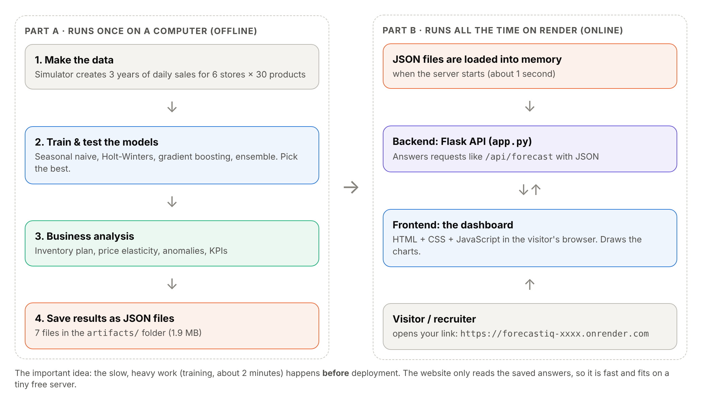

The project has **two halves**, and understanding this split is the single most important idea in the whole guide.

**Part A: the offline pipeline (the "kitchen").** This is a Python program you run once (or whenever you want fresh results). It makes the data, trains the models, tests them, does the business analysis and saves all the answers to files. It takes about 2 minutes and needs a fair amount of computing power.

**Part B: the online web app (the "restaurant counter").** This runs all the time on a server on the internet. When it starts, it reads the saved answers into memory. When a visitor opens the website, it hands over the answers they ask for. It never trains a model, so it is fast and tiny.

> **Analogy:** a restaurant cooks the biryani in the morning (kitchen) and serves plates all day from the counter. The counter doesn't need a stove. Our website doesn't need the machine-learning library at all.

## Basic words you need

**Server.** A computer that is always on and connected to the internet, waiting for requests. Render gives us one for free.

**Browser.** Chrome, Safari, etc. It asks servers for pages and shows them.

**Frontend.** Everything that runs **inside the visitor's browser**: the page layout (HTML), the colours and fonts (CSS), and the interactive behaviour and charts (JavaScript). In this project: the `templates/` and `static/` folders.

**Backend.** Everything that runs **on the server**: receiving requests, finding the right data, sending it back. In this project: `app.py` (and the `forecastiq/` code it uses).

**API (Application Programming Interface).** A list of "doors" the backend offers, each with an address (a URL). For example, the door `/api/forecast?node=category:Apparel` returns the forecast for Apparel. The frontend knocks on these doors to get data. Part 14 explains the full journey.

**JSON (JavaScript Object Notation).** A simple text format for data that both Python and JavaScript understand. It looks like this:

```json
{"label": "Apparel", "forecast": [812.4, 790.1, 805.7], "bt_wape": 0.0569}
```

**Artifacts.** In machine learning, the files a training run produces. Ours are 7 JSON files in the `artifacts/` folder.

## "Is there a database?"

**No, and that's a deliberate choice.**

A **database** (like MySQL, PostgreSQL or MongoDB) is software for storing data that changes often and is written by many users at once: bank balances, orders, user accounts.

Our website **only reads** data and never writes it. The data changes only when the pipeline is re-run. For read-only data of 1.9 MB, plain JSON files loaded into memory are:

- **faster** (memory is faster than any database query),
- **simpler** (nothing extra to install, configure or secure),
- **free** (Render's free database is deleted after a limited period; JSON files never expire),
- **easy to inspect** (open the file and read it).

**When would you add a database?** If you connected real sales data that arrives every day, let users log in, or let users save their own scenarios. Then you'd store sales in PostgreSQL and have the pipeline read from it. Saying this in an interview shows you understand the trade-off.


# Part 4. The data: the inputs to everything

## Why the data is simulated

Real store-level daily sales data is private business data, and companies rarely share it. Public datasets exist (Walmart's M5 competition data, Favorita, Rossmann on Kaggle), but they are large, and the computer we built this on had **no internet access** to download anything.

So we wrote a **simulator**: a program that generates realistic sales data from a recipe. This turned out to be a strength:

> Because **we** wrote the recipe, we know the **true answers** (for example, the true price sensitivity of Electronics is exactly -2.2). So we can check whether our analysis finds the truth. With real data you can never check this, because nobody knows the truth.

This idea is called **ground truth**. You must always say the data is simulated, in your resume, on the website (it says "Simulated data" at the top) and in interviews. Never present it as real company data.

## The ingredients (what's in the dataset)

**Stores** (in `forecastiq/config.py`):

| Store | City | Region | Size (relative) | Yearly growth |
|---|---|---|---|---|
| S01 | Bengaluru | South | 1.30 | +10% |
| S02 | Hyderabad | South | 1.00 | +7% |
| S03 | Chennai | South | 0.85 | +2% |
| S04 | Mumbai | West | 1.45 | +5% |
| S05 | Pune | West | 0.75 | +12% |
| S06 | Delhi | North | 1.20 | -2% |

**Categories** (6 products each, 30 in total):

| Category | Typical daily sales per store | Price range (₹) | Price sensitivity (true) | Promotion boost (true) | Diwali effect |
|---|---|---|---|---|---|
| Grocery | 40-120 | 40-400 | -0.8 | +10% | small |
| Personal Care | 15-50 | 100-600 | -1.1 | +15% | small |
| Home & Kitchen | 6-25 | 300-3,000 | -1.4 | +20% | large |
| Apparel | 5-20 | 500-3,000 | -1.8 | +25% | very large |
| Electronics | 1.5-8 | 1,500-12,000 | -2.2 | +28% | largest |

Each product also gets a random cost margin, a supplier **lead time** (how many days a delivery takes: 2-4 days for Grocery, 8-14 for Electronics) and its own life-cycle trend (some products are growing, some declining).

**Festival calendar:** Diwali, Dussehra, Holi, Eid al-Fitr, Raksha Bandhan, Ganesh Chaturthi, Independence Day, Republic Day, Christmas, New Year and Pongal, with their real (approximate) dates for each year, because festivals in India move every year.

## The recipe for one day's sales

For every product, in every store, on every day, the simulator calculates the **expected sales** by starting from a base level and multiplying in effects:

1. **Base level:** the product's normal daily sales × the store's size.
2. **Trend:** the store's growth + the product's own trend, compounding over the years.
3. **Weekly pattern:** Saturday and Sunday are higher (Apparel +40%, Grocery +18%); Friday a little higher.
4. **Yearly pattern:** a smooth wave peaking at a different time of year for each category.
5. **Price effect:** if the price is 10% above normal, sales fall by about (price sensitivity × 10%). Electronics loses about 22%, Grocery about 8%.
6. **Promotion effect:** promotions run about 8 times a year for 4-10 days at 10-30% off, more often just before Diwali. On a promotion, sales get an extra boost on top of the discount effect.
7. **Diwali shape:** sales build up over the 12 days before Diwali, peak, then dip for a few days after (people already bought everything).
8. **Other festivals:** a +12% bump on the day and the day before.
9. **Payday:** +5% on the 1st-3rd of each month.
10. **Store-week noise:** small random ups and downs shared by all products in a store that week (a local event, the weather).
11. **"Sticky" noise:** random wobble where a good day tends to be followed by another good day (in statistics this is called an **AR(1)** process, "autoregressive").

Then comes the final step: real sales are whole numbers and random. The expected value is turned into an actual number of units using a **negative binomial distribution**, a standard way of generating random counts that vary more than a simple coin-toss model would. If the expected sales are 20, the actual sales might be 14 or 27.

**Planted problems:** finally, the simulator hides about 3 problems per product-store pair in the history: **stock-outs** (2-5 days of zero sales) and **spikes** (1-2 days with 2.5-4 times normal sales). It records exactly where it put them (548 events in total), so we can test the anomaly detector later.

**Prices also move:** list prices rise 5% each year, and there are small weekly price experiments of ±2-4%. This price variation is what lets us measure price sensitivity later.

**The future:** the simulator also creates the **next 28 days** (1-28 Nov 2026) of *planned* prices, promotions and calendar information, but **not** the sales. A real business knows its own price and promotion plans in advance, so it is fair for the model to use them.

**Inventory on hand:** for the inventory page we also need to know how much stock each store has right now. The simulator creates this too: each pair gets a random number of days' worth of stock (typically around 26 days, with big variation).

## What the final table looks like

One row per product, per store, per day:

| date | store_id | sku_id | category | units | price | list_price | promo | discount | unit_cost | days_from_major |
|---|---|---|---|---|---|---|---|---|---|---|
| 2023-11-01 | S01 | GRO-01 | Grocery | 81 | 110.0 | 110.0 | 0 | 0.0 | 87.04 | -11 |
| 2023-11-03 | S01 | GRO-01 | Grocery | 194 | 110.0 | 110.0 | 0 | 0.0 | 87.04 | -9 |

(`days_from_major` = days to/from Diwali; -9 means 9 days before Diwali, which is why sales are high on 3 Nov 2023.)

- **SKU** means "Stock Keeping Unit": a code for one specific product, like `GRO-01` (Grocery product 1).
- **series_id** combines store and product, like `S01|GRO-01`. Each series is one line of sales over time.
- Size: **197,280 rows** (180 series × 1,096 days), plus **5,040 future rows** (180 × 28).

> **Problem we faced: one category swallowed the whole business.**
> In the first version, Electronics prices ranged up to ₹40,000. Electronics alone made ₹423 crore of revenue over three years, while every other category made ₹40-75 crore. Every revenue chart was just "Electronics plus a thin line". That isn't realistic for a general retailer, and it made the other categories impossible to see.
> **Fix:** we narrowed the Electronics price range to ₹1,500-12,000. Electronics is still the biggest category (₹167 crore) but no longer drowns the rest.

> **Problem we faced: the simulated stock levels were unrealistic.**
> The first stock snapshot gave each pair about 16 days of stock. That made 50 of the 180 pairs "Critical" (about to run out), which no real business would tolerate.
> **Fix:** we changed it to about 26 days of stock with variation. Now 24 are Critical, 3 need reordering, 13 are overstocked and 140 are healthy, which is a realistic mix and gives the inventory page something interesting to show.
> **Honest note:** this means the stock numbers were tuned to make a good demo. Say so if asked.

> **Honest caveat about ground truth.**
> The simulator builds sales with the same kind of formula (multiplying effects together, "log-linear") that our price analysis later assumes. That makes it easier for the analysis to find the truth than it would be with real data. The checks prove the code works correctly; they don't prove it would be equally accurate on messy real data.


# Part 5. Forecasting basics in plain words

**Time series.** A list of numbers in time order, like daily sales of `S01|GRO-01`. We have 180 time series.

**Forecast.** A guess about future values of a time series.

**Horizon.** How far ahead we forecast. Ours is **28 days** (4 weeks), a common planning cycle in retail.

**Grain (or granularity).** The level of detail. Ours is **product × store × day**, the most detailed level, which is also the hardest to forecast.

**Hierarchy.** The levels you can add up to: product-store → product, store, category, region → whole company. If you forecast the detailed level and **add up** the forecasts to get the higher levels, that is called **bottom-up** forecasting, and it guarantees all levels agree with each other. We do this. (The opposite would be forecasting each level separately, where "Grocery" might not equal the sum of its products.)

**Seasonality.** A pattern that repeats on a fixed cycle: weekly (weekends), yearly (festivals, summer).

**Trend.** Slow long-term growth or decline.

**Noise.** The random part that cannot be predicted.

**Point forecast vs. interval forecast.** A point forecast is one number ("450"). An interval forecast is a range ("between 410 and 520"). Businesses need both: the point to plan, the range to decide how much safety stock to keep.

**Training data vs. test data.** The model learns from the training data. We judge it on test data it has **never seen**, otherwise it's like giving a student the exam answers before the exam.

**Overfitting.** When a model memorises the training data instead of learning general patterns. It looks brilliant on old data and fails on new data. Proper testing on unseen data catches this.


# Part 6. Features: the clues we give the model

A machine-learning model can't look at a calendar or understand "Diwali". We have to turn everything into numbers in columns. Each column is a **feature**: a clue that might help predict sales. Creating them is called **feature engineering**, and it is often the part that matters most.

We built **30 features** (in `forecastiq/features.py`):

| Group | Features | What it tells the model |
|---|---|---|
| **Past sales (lags)** | `lag_28`, `lag_35`, `lag_42`, `lag_49`, `lag_56`, `lag_364` | Sales exactly 4, 5, 6, 7, 8 weeks ago, and one year ago (same weekday) |
| **Recent averages** | `roll_mean_7`, `roll_mean_28`, `roll_mean_56` | Average daily sales over the last 1, 4 and 8 weeks (counted from 28 days back) |
| **Variability & shape** | `roll_std_28`, `same_dow_mean`, `trend_ratio`, `zero_share_28` | How jumpy sales are; usual sales on this weekday; is it growing or shrinking; how often it sold zero |
| **Price & promotion** | `price`, `rel_price`, `discount`, `promo`, `promo_lead_7` | Today's price; price compared to its normal level; discount %; is there a promotion; is one coming in the next week |
| **Calendar** | `dow`, `dom`, `month`, `doy`, `is_weekend`, `is_month_start` | Day of week, day of month, month, day of year, weekend flag, payday flag |
| **Festivals** | `is_holiday`, `days_from_holiday`, `days_from_major` | Is it a festival; how many days to/from the nearest festival; days to/from Diwali |
| **Identity** | `store_code`, `sku_code`, `cat_code` | Which store, product and category this row is |

**What's a "lag"?** "Lag 28" for 29 November means "the sales on 1 November". It's just looking back in time by 28 days.

**What's a "rolling mean"?** The average of a moving window. "Rolling mean 7" on each day = the average of the 7 days before it. It smooths out noise.

## The most important rule: no peeking at the future (leakage)

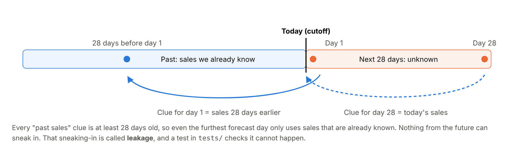

Suppose on 31 October we want to forecast 28 November. A clue like "sales yesterday" (27 November) is **not known yet** on 31 October. If we accidentally used it during testing, the model would look amazing in tests and fail in real life. Using information that wouldn't really be available is called **data leakage**. It is the most common mistake in forecasting projects.

Our protection: **every sales-based feature is at least 28 days old** (the length of the horizon). So for any of the 28 forecast days, every sales clue comes from before "today". Price, promotion and calendar features are **not** lagged because the business genuinely knows its own plans in advance.

This approach is called a **direct, non-recursive** forecast:

- **Recursive** (the other approach): forecast tomorrow, then use that forecast as "yesterday's sales" to forecast the day after, and so on. Errors snowball.
- **Direct** (ours): one model predicts all 28 days in one go using only real, known data. No forecast is ever fed back in.

There is an **automatic test** for this (`test_features_do_not_leak_the_forecast_window` in `tests/test_pipeline_parts.py`): it deliberately overwrites the last 27 days of sales with nonsense (9,999 units) and checks that the features for the forecast days don't change at all. If someone later breaks the rule, the test fails.

> **Trade-off to know for interviews:** because the newest sales clue is 4 weeks old, the model can't react to something that happened last week. In exchange we get honest tests and one simple model for all 28 days. A real company might add separate short-horizon models for the first few days.


# Part 7. The models

We built **four** forecasting approaches, from very simple to advanced, and let them compete.

## Model 1: Seasonal naive (the benchmark)

**Rule:** "Next Monday will sell the same as last Monday." Repeat the last week for 4 weeks.

It sounds silly, but it's surprisingly hard to beat and it's the standard **benchmark**. If a fancy model can't beat it, the fancy model is useless. Every serious forecasting project must report a benchmark like this.

## Model 2: Holt-Winters exponential smoothing (classical statistics)

A classic method from the 1960s, still widely used. It keeps track of three things and updates them a little every day:

- **Level:** "how much does this product sell on a normal day right now?"
- **Trend:** "is that going up or down, and how fast?"
- **Season:** "how much higher or lower is each weekday than normal?"

Each day, when the real sales arrive, it nudges each of the three towards what it just saw. How big the nudge is depends on three settings, called **smoothing parameters**:

- **alpha (α)** for the level: big alpha = react fast to new data; small = stay calm.
- **beta (β)** for the trend.
- **gamma (γ)** for the season.

We also use a **damped trend** (setting **phi, φ**): the trend fades out over the horizon instead of continuing forever. Without damping, a product that grew a bit last month would be forecast to grow forever, which is usually wrong.

**Extra details:**

- It works on the **logarithm** of sales (`log(1 + sales)`), which turns "×1.2 on weekends" into "+0.18", so effects add up nicely and forecasts can never go below zero.
- **Parameter search:** for each of the 180 series, it tries 90 combinations of alpha, beta, gamma and phi, and keeps the combination that would have predicted that series' history best. The typical (median) winner was α = 0.2, β = 0, γ = 0.1, φ = 0.9.
- It is **vectorised**: instead of looping over 180 series one by one, it updates all 180 at once using NumPy arrays, so fitting all of them takes a few seconds.

> **Problem we faced: the usual libraries weren't available.**
> Normally you'd use a ready-made library for Holt-Winters (`statsmodels`), for gradient boosting (`LightGBM` or `XGBoost`), for forecasting (`Prophet`), and for the website (`Streamlit` or `Plotly`). None of these were installed on the computer we built on, and it had no internet to install them.
> **Fix:** we wrote Holt-Winters ourselves from the formulas (`forecastiq/models.py`, about 60 lines), used scikit-learn's built-in gradient boosting, and drew the charts by hand.
> **Silver lining:** writing Holt-Winters yourself shows you understand it, and the deployed app ended up much smaller (it needs only 5 libraries).

**Its weakness:** Holt-Winters only looks at the sales history. It **can't see prices, promotions or Diwali**. So it is always surprised by them.

## Model 3: Global gradient boosting (machine learning, the winner)

### Decision trees first

A **decision tree** is like the game "20 questions":

> Is the 8-week average above 50? → Yes → Is it a weekend? → Yes → Is there a promotion? → Yes → **Predict 74 units.**

The computer learns which questions to ask, and in which order, from the training data.

### Boosting

One tree is crude. **Gradient boosting** builds **hundreds of small trees one after another**, where each new tree focuses on fixing the mistakes the previous trees still make. Think of a team of students checking each other's homework: the first gets the rough answer, the second corrects the biggest errors, the third fixes what's left, and so on. Together they're far better than any one alone.

We use scikit-learn's `HistGradientBoostingRegressor` with 300 trees. "Hist" means it groups values into bins first, which makes it fast on large data.

### "Global"

There is **one model for all 180 series**, not one per series. The `store_code` and `sku_code` features tell it which series a row belongs to. This lets it learn shared patterns ("weekends boost Apparel", "promotions boost everything", "Diwali build-up looks like this") from all products at once. A slow-selling product with little data of its own benefits from what the model learned from busy products. Global models won most of the big modern forecasting competitions (e.g. M5).

### Poisson objective

Models learn by trying to reduce a **loss**: a score of how wrong they are. The usual loss assumes errors are symmetric and the same size everywhere. But sales are **counts** (0, 1, 2, ...): they can't be negative, and a product selling 1,000 a day naturally wobbles more than one selling 2 a day. The **Poisson loss** is designed for counts and respects both facts. It's a small setting (`loss="poisson"`) that matters a lot.

### Quantile models for the ranges

We also train **two more** gradient boosting models with a **quantile loss** (also called **pinball loss**): one learns the 10th percentile ("sales will be above this 90% of the time") and one the 90th percentile ("below this 90% of the time"). Between them lies an 80% range. Part 9 explains how we make these ranges trustworthy.

### What the model relies on most

We measured **feature importance** by **permutation**: shuffle one feature's column randomly (destroying its information) and see how much worse the predictions get. The bigger the damage, the more the model relied on that feature.

| Feature | Extra error when shuffled (units per day) |
|---|---|
| `roll_mean_56` (average of last 8 weeks) | 18.71 |
| `sku_code` (which product) | 3.14 |
| `roll_mean_28` (average of last 4 weeks) | 1.31 |
| `rel_price` (price vs normal) | 1.04 |
| `roll_std_28` (how jumpy sales are) | 0.68 |
| `dow` (day of week) | 0.53 |
| `store_code` (which store) | 0.47 |
| `discount` | 0.44 |

How to explain this: "The model first works out the product's normal sales level, then adjusts it for price, promotions and day of the week." Exactly what a human planner would do.

## Model 4: The weighted ensemble

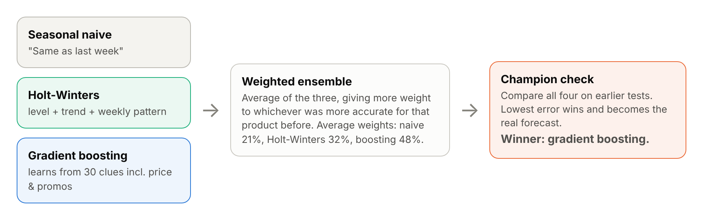

An **ensemble** combines several models. Ours averages the three models above, but gives each one a **weight** based on how accurate it was for **that specific product** in earlier tests. The weights are "inverse error": a model with half the error gets four times the weight (we used error to the power of 2). On average the weights came out as: seasonal naive 21%, Holt-Winters 32%, gradient boosting 48%.

Ensembles often win because different models make different mistakes that partly cancel out.

> **Problem we faced: the ensemble lost.**
> Our plan was for the ensemble to be the final model. But in testing it was **worse** than gradient boosting alone: 27.8% error vs 25.9%.
> We investigated and tried several fixes, measured on the same tests:
>
> | What we tried | Error (WAPE) |
> |---|---|
> | Gradient boosting alone | **25.85%** |
> | Ensemble, weights power 2 (original) | 27.75% |
> | Ensemble, power 4 | 26.98% |
> | Ensemble, power 8 | 26.45% |
> | Ensemble, power 16 | 26.32% |
> | Drop seasonal naive, keep Holt-Winters + boosting, power 16 | 26.25% |
> | Simple 50/50 average of Holt-Winters and boosting | 27.10% |
>
> Nothing beat the single model. **Why:** Holt-Winters and seasonal naive can't see prices, promotions or festivals. Mixing them in pulls the good model's forecasts towards a less informed answer. Ensembles help when the members are similarly good and make *different* mistakes; here one member simply knows more.
> **Fix:** instead of forcing the ensemble, we added a **champion/challenger** step: after each test round, the model with the lowest error so far becomes the "champion" and is used as the real forecast. The others stay as "challengers" and are still tracked. Gradient boosting won.
> **Why this is a good story:** it shows you test your assumptions instead of believing "ensembles always win", and that you report results honestly. The dashboard even has a note about it.


# Part 8. Testing the models honestly

## Why you can't just shuffle the data

In many machine-learning projects you randomly split the data 80/20 into training and test sets. **With time series you must never do that.** A random split would let the model learn from Thursday to predict Wednesday. In real life you only ever have the past. So the test must always be "learn up to a date, predict after it".

## Rolling-origin backtesting

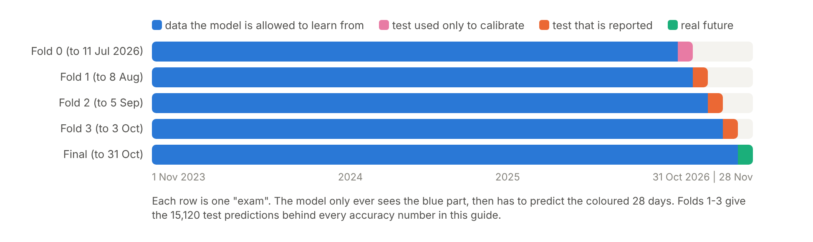

A **backtest** asks: "if we had used this model in the past, how well would it have done?" We do this **four times**, each time pretending "today" is a different date:

| Round ("fold") | Model trained on data up to | Then forecasts | Used for |
|---|---|---|---|
| Fold 0 | 11 Jul 2026 | 12 Jul - 8 Aug | Only to calibrate (warm-up) |
| Fold 1 | 8 Aug 2026 | 9 Aug - 5 Sep | Reported results |
| Fold 2 | 5 Sep 2026 | 6 Sep - 3 Oct | Reported results |
| Fold 3 | 3 Oct 2026 | 4 Oct - 31 Oct | Reported results |
| Final | 31 Oct 2026 | 1 - 28 Nov 2026 | The real forecast shown on the website |

This is called **rolling-origin** (or "walk-forward") evaluation because the "today" point rolls forward. Folds 1-3 give **3 × 28 days × 180 series = 15,120 forecasts** we can compare with what really happened.

**Extra strictness:** the ensemble weights, the champion choice and the range calibration used in fold 2 are calculated only from folds 0 and 1, never from fold 2 itself. So every reported number is truly "out of sample" (from data the system hadn't seen).

## The scorecards (metrics)

A tiny example to explain them. Real sales over three days: **10, 20, 30**. Forecasts: **12, 18, 30**. Errors: 2, 2, 0.

| Metric | Full name | How it's calculated | Example | Meaning |
|---|---|---|---|---|
| **MAE** | Mean Absolute Error | average size of errors | (2+2+0)/3 = 1.33 | "wrong by 1.33 units on average" |
| **RMSE** | Root Mean Squared Error | square errors, average, square root | 1.63 | like MAE but punishes big misses more |
| **WAPE** | Weighted Absolute Percentage Error | total error ÷ total sales | 4/60 = 6.7% | "error is 6.7% of volume". **Our main metric.** |
| **Bias** | | total (forecast - actual) ÷ total actual | 0% | are we systematically too high (+) or too low (-)? |
| **MASE** | Mean Absolute Scaled Error | our MAE ÷ the naive method's MAE | | below 1 = better than the naive method |
| **sMAPE** | symmetric MAPE | percentage error that treats over- and under-forecasts alike | | a common competition metric |

**Why not the famous MAPE?** MAPE divides each error by that day's sales. If sales were zero, you divide by zero, and for slow products selling 1-2 a day it explodes. WAPE avoids this by dividing **totals**, which also means busy products count more, which is what a business cares about.

## Results

| Model | WAPE | MASE | MAE | RMSE | sMAPE | Bias |
|---|---|---|---|---|---|---|
| Seasonal naive | 39.1% | 1.075 | 16.17 | 31.88 | 48.6% | -3.3% |
| Holt-Winters | 31.6% | 0.880 | 13.09 | 25.96 | 40.1% | -8.0% |
| **Gradient boosting (champion)** | **25.9%** | **0.706** | **10.69** | **21.26** | **32.5%** | **-0.5%** |
| Weighted ensemble | 27.8% | 0.759 | 11.48 | 22.99 | 34.5% | -3.6% |

How to read this:

- Gradient boosting has **34% less error** than the benchmark: (39.1 - 25.9) ÷ 39.1.
- Its **bias is almost zero** (-0.5%): it is not systematically too high or too low. Holt-Winters under-forecasts by 8%, because it misses the promotions and the festival build-up.
- MASE of 0.71 means its errors are about 71% of the naive method's.

## Is 25.9% error bad?

No, and here is how to explain why. At the most detailed level (one product, one store, one day), a big part of what's left is **pure randomness** that no model can predict. When you add up forecasts, random errors **cancel out**:

| Level | Gradient boosting WAPE | Seasonal naive WAPE |
|---|---|---|
| Product × store × day | 25.9% | 39.1% |
| Product × day (all stores) | 11.7% | 18.2% |
| Store × day | 7.7% | 12.5% |
| Category × day | 5.7% | 9.6% |
| **Whole company × day** | **3.5%** | 6.5% |
| Product × store × whole 4 weeks | 8.9% | 17.9% |

The last row is very useful in practice: purchasing usually cares about the **total for the next few weeks**, not a single day, and there the error is under 9%.

## Other things the tests showed

- **Accuracy doesn't get worse further out.** Error is about 25.7% in week 1 and 25.9% in week 4. Normally forecasts get worse the further ahead you look. Ours don't because of the direct design: every forecast day uses the same 28-day-old information, so day 1 has no advantage over day 28.
- **By category:** Grocery is easiest (23.7% error, it sells a lot and steadily). Electronics is hardest (34.5%, it sells few units with big swings).
- **The champion was best for 166 of the 180 series;** Holt-Winters was best for 14 and seasonal naive for none.


# Part 9. "How sure are you?" Prediction intervals

## The idea

Instead of "we will sell 450", say "we will probably sell between 410 and 520". An **80% prediction interval** should contain the real value 80% of the time. If it contains it only 60% of the time, the ranges are too narrow (overconfident). If 98%, they're too wide (useless).

The percentage of times the real value lands inside the range is called **coverage**. Our target is 80%.

## Step 1: quantile models

As described in Part 7, two extra gradient boosting models learn the 10th and 90th percentiles directly. Between them is a raw 80% range.

## Step 2: conformal calibration (the clever bit)

Raw ranges from models are usually a bit too narrow. On our backtest the raw ranges covered only **76.9%** instead of 80%.

**Conformal prediction** fixes this with a simple, assumption-light idea:

> Look at the past tests. For each one, measure **how far outside the range** the real value fell (or, if inside, how far inside). Find the amount by which you would have needed to widen the ranges so that 80% of past values fit. Widen all future ranges by that amount.

It's like a tailor who notices their shirts were always 2 cm too tight and adds 2 cm to every new shirt. The specific version we use is called **Conformalised Quantile Regression (CQR)**. We also scale the widening by product size (square root of the forecast), so a product selling 1,000 a day gets a bigger widening than one selling 5.

Again, for each fold the widening is calculated only from **earlier** folds.

**Result:** coverage moved from **76.9% to 78.7%**, very close to the 80% target, and consistent across categories (77.8% to 79.6%) and folds (78.1% to 79.2%).

> **Problem we faced: the ranges were overconfident, then over-corrected, then landed slightly short.**
> In the very first version, the raw ranges covered only 73.7%. After conformal calibration they jumped to 81.2%. That version centred the ranges on the ensemble forecast. When we switched to the champion model (gradient boosting), the raw coverage became 76.9% and the calibrated coverage 78.7%.
> **Why still slightly under 80%:** the calibration learns from older weeks, and the most recent weeks were a bit more volatile than the older ones. Conformal guarantees assume the future looks like the calibration data; when things drift, coverage drifts a little too.
> **Be honest about it:** "78.7% against an 80% target, slightly under" is the right way to say it. It's in the README too.


# Part 10. Turning forecasts into business decisions

A forecast alone doesn't make money. Decisions do. This part covers the "Business Intelligence" half. All of this lives in `forecastiq/analytics.py`.

## 10.1 KPIs (key performance indicators)

The Overview page shows the numbers a manager checks first:

| KPI | Value | Meaning |
|---|---|---|
| Revenue, last 28 days | ₹13.87 crore | money from sales (price × units) |
| Forecast revenue, next 28 days | ₹15.85 crore | +14.3%, mainly because Diwali (8 Nov) falls in the window |
| Gross margin | 26.1% | (price - cost) ÷ price: how much of each rupee is profit before other costs |
| Forecast accuracy | 74.1% | 1 - WAPE |
| SKUs needing replenishment | 27 | Critical + Reorder |

**Comparing periods fairly.** Revenue looks 15.7% **down** compared with the same 4 weeks last year. Panic? No: last year's window (Oct 2025) contained Diwali, and this year's (Oct 2026) didn't, because Diwali moved from 20 October 2025 to 8 November 2026. The dashboard writes this explanation automatically by checking which festivals fell in each window. This kind of "the number is misleading because of the calendar" insight is exactly what good BI is for.

## 10.2 ABC-XYZ segmentation

A classic way to sort products into groups that need different treatment.

**ABC (how important is it?)** by revenue over the last year:

- **A** = the products that together make the top 80% of revenue (few products, most of the money).
- **B** = the next 15%.
- **C** = the last 5%.

**XYZ (how predictable is it?)** by how much weekly sales jump around. The measure is the **coefficient of variation (CV)** = standard deviation ÷ average:

- **X** = steady (CV ≤ 0.20)
- **Y** = moderately variable (0.20 - 0.35)
- **Z** = erratic (above 0.35)

Our result (number of product-store pairs):

|   | X (steady) | Y | Z (erratic) |
|---|---|---|---|
| **A** (top 80% revenue) | 17 | 41 | 35 |
| **B** (next 15%) | 16 | 18 | 16 |
| **C** (last 5%) | 15 | 16 | 6 |

How a business uses it: **AX** items are important and easy, automate them. **AZ** items (35 of them, 37% of revenue) are important and hard, give them the most attention and the most safety stock. **CZ** items are cheap and erratic, maybe stock fewer of them.

## 10.3 Inventory planning

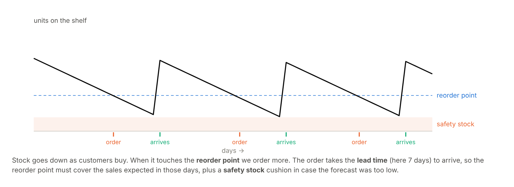

We use a standard policy from operations research called a **continuous-review (s, Q) policy**: watch stock all the time; when it falls to the **reorder point (s)**, order a fixed **quantity (Q)**.

**Lead time (L):** how long an order takes to arrive. In our data: 2-14 days depending on the product.

**Safety stock:** extra cushion in case sales are higher than forecast during the lead time.

```
safety stock = z × σ × √L
```

- **σ (sigma)** = how wrong the forecast typically is per day for this product. We use the **forecast's real errors from the backtest**, not the raw ups and downs of sales. This matters: the forecast already expects the weekend rush and Diwali, so you only need a cushion for what the forecast gets wrong, not for patterns it already knows. This is a smarter, more modern approach than many textbooks show, and it is a good interview point.
- **√L**: uncertainty grows with time, but not in a straight line. Over 4 days it's twice (√4 = 2) one day's uncertainty, not four times, because good and bad days partly cancel.
- **z** comes from the **service level**: the chance of not running out during a lead time. We set 98% for A items, 95% for B, 90% for C. A 98% service level gives z ≈ 2.05; 90% gives z ≈ 1.28.

**Reorder point** = forecast sales over the lead time + safety stock.

**How much to order: EOQ (Economic Order Quantity).** Ordering often costs a lot in order fees (₹500 per order in our assumptions); ordering rarely means big piles of stock that cost money to hold (20% of the item's cost per year). EOQ is the classic formula that balances the two:

```
EOQ = √( 2 × yearly demand × order cost ÷ yearly holding cost per unit )
```

**Worked example from the real output** (Bengaluru, product APP-02, Apparel, class AZ):

| Item | Value |
|---|---|
| Stock on hand | 360 units |
| Forecast | 25.6 units per day |
| Lead time | 10 days |
| Forecast error σ | 7.14 units/day |
| Service level (class A) | 98% → z ≈ 2.05 |
| Safety stock | 2.05 × 7.14 × √10 ≈ **46** |
| Reorder point | ≈ forecast for next 10 days + 46 ≈ **431** |
| Days of cover | **8 days** (the stock will last about 8 days) |
| **Status** | **Critical**: 8 days of stock but deliveries take 10 days. It will run out before a new order arrives. |
| Recommended order | **299 units** (≈ ₹2.67 lakh) |
| Revenue at risk | ≈ ₹44,000 of sales that can't be served |

**Status rules:**

| Status | Rule | Count |
|---|---|---|
| Critical | stock < forecast sales during the lead time | 24 |
| Reorder | stock ≤ reorder point | 3 |
| Overstock | more than 60 days of stock | 13 |
| Healthy | everything else | 140 |

Totals: recommended orders ₹1.25 crore, revenue at risk ₹66.9 lakh, money stuck in excess stock ₹89.6 lakh.

## 10.4 Price elasticity: how much does price matter?

**Price elasticity** = the % change in sales when price changes by 1%.

- Elasticity **-0.8** (Grocery): raise the price 10% → sales drop about 8%. Customers aren't very sensitive (you need rice anyway). This is called **inelastic**.
- Elasticity **-2.2** (Electronics): raise the price 10% → sales drop about 22%. Customers shop around. This is called **elastic**.
- The dividing line is **-1**. If demand is elastic (below -1), cutting the price **increases revenue** because the extra units more than make up for the lower price. If inelastic, cutting the price loses revenue.

### How we measured it

We can't just compare "days with high prices" against "days with low prices", because low prices happen during promotions, which happen before Diwali, when sales are high anyway. A naive comparison would credit the price for what Diwali did. This is the classic problem of **confounding**.

So we use a regression that **controls** for the other effects at the same time:

```
sales ≈ exp( elasticity × log(price) + promo effect
             + one adjustment per product-store   (fixed effects)
             + day-of-week + month + festival-window adjustments )
```

The words to know:

- **Regression:** a method that finds the numbers in a formula that best fit the data.
- **Poisson regression (PPML, Poisson Pseudo-Maximum Likelihood):** a regression made for counts like sales, including zeros. The common alternative (taking logs and running ordinary least squares) breaks when sales are zero, because log(0) doesn't exist. Economists use PPML for exactly this reason.
- **Fixed effects:** one separate "base level" per product-store pair, so the comparison is always "this product at a higher price vs **the same product** at a lower price", never "an expensive TV vs cheap soap".
- **IRLS (Iteratively Reweighted Least Squares):** the step-by-step algorithm we wrote to solve the Poisson regression. It starts with a guess and improves it repeatedly until it stops changing.
- **Cluster-robust standard errors:** the "±" uncertainty on the result. Sales on consecutive days of the same product are related (not independent), which would normally make us overconfident. "Clustering by series" corrects for that. It gives the 95% confidence intervals shown in the dashboard.

### Results vs. the truth

| Category | Estimated elasticity | 95% interval | True value | Estimated promo boost | True boost |
|---|---|---|---|---|---|
| Grocery | -0.82 | -0.94 to -0.70 | -0.80 | +9.8% | +10.5% |
| Personal Care | -1.10 | -1.23 to -0.98 | -1.10 | +15.6% | +15.0% |
| Home & Kitchen | -1.39 | -1.52 to -1.26 | -1.40 | +19.0% | +19.7% |
| Apparel | -1.75 | -1.88 to -1.62 | -1.80 | +24.6% | +24.6% |
| Electronics | -2.23 | -2.38 to -2.09 | -2.20 | +28.2% | +28.4% |

Every estimate is within 0.05 of the truth, and every true value lies inside its 95% interval. This is the payoff of using simulated data with known ground truth. (Remember the honest caveat from Part 4: the simulator uses the same type of formula, which makes this easier than with real data.)

**Promotion boost** here means the extra sales from running a promotion **over and above** the effect of its discount: the banner, the advertising, the "SALE" sign.

## 10.5 The what-if simulator

On the Pricing page you move a slider ("change price by -30% to +30%"), pick a category, a store and whether it's a promotion. The server takes the next 28 days of forecast and applies:

```
new units = forecast units × (1 + price change) ^ elasticity × (1 + promo boost if promotion)
```

Then it calculates units, revenue and gross margin before and after, and draws a curve of revenue and margin across all price changes.

> **Problem we faced: the simulator gave a misleading answer.**
> The curve said margin is highest at **+30%**, the edge of the slider. That doesn't mean "raise prices 30%". It means the simple formula keeps rewarding price rises across the whole range, because it ignores competitors reacting, customers switching to other products, and the fact that sensitivity changes when price moves a lot.
> **Fix:** the page now says, when the best point is at the edge, "margin keeps rising as price rises across the whole tested range, so read this as a direction rather than a target", plus a sentence about the model's limits. The vertical "margin peak" marker is only drawn when there is a real peak inside the range.

## 10.6 Anomaly detection

**Anomaly** = a sale that the normal pattern can't explain. Examples: a stock-out (zero sales because the shelf was empty, not because nobody wanted it), a data-entry error, an unexpected bulk purchase.

How the detector works (`detect_anomalies` in `analytics.py`):

1. **Expected sales** for each day = the **median** of the same weekday over the previous 8 weeks (only non-promotion days). The median is used instead of the average because it ignores occasional wild values. On promotion days, the expected value is raised by that product's typical promotion uplift.
2. **How much variation is normal?** Counts follow the negative binomial pattern from Part 4: variance = expected + a × expected². The extra-spread number **a** is estimated separately for each product in a robust way.
3. **z-score** = (actual - expected) ÷ normal variation. A z-score of 5 means "5 times further from expected than usual". We flag |z| > 4.5.
4. **Runs of zeros:** for slow products, one zero-sales day is normal. But 4 zeros in a row might be impossible by chance. We calculate the probability of the whole run and flag it if it's as unlikely as a 4.5 z-score. This catches stock-outs on slow sellers.
5. **Festival windows are skipped**, because a Diwali spike is expected, not suspicious.

Results: **1,532** days flagged across three years; **64%** of flagged days were genuinely planted problems (**precision**); **395 of 548** planted events were found (**recall**: 72%).

**Precision vs. recall** in simple words: precision = "when the alarm rings, how often is there really a fire?" Recall = "of all the fires, how many did the alarm catch?" Making the alarm more sensitive catches more fires but rings falsely more often. You always trade one against the other.

> **Problem we faced: the first anomaly detector was poor.**
> The first version used a simpler robust z-score (median and "median absolute deviation"). It found only 44% of planted events, and only 21% of its alarms were real.
> **Fix:** we rewrote it with the count-aware negative binomial noise model, promotion-adjusted expectations, and the zero-run check. Then we tried several thresholds:
>
> | Threshold |z| | Precision | Recall |
> |---|---|---|
> | 3.5 | 37% | 80% |
> | 4.0 | 51% | 76% |
> | **4.5 (chosen)** | **64%** | **72%** |
> | 5.0 | 73% | 68% |
>
> We chose 4.5 as a balance.
> **Honest note:** we chose the threshold by looking at the planted truth, so the 64%/72% figures are slightly optimistic: the threshold was tuned and evaluated on the same data. In a real project you'd tune on one period and report on another. Say this if asked; it shows you understand evaluation.


# Part 11. The pipeline: the "kitchen"

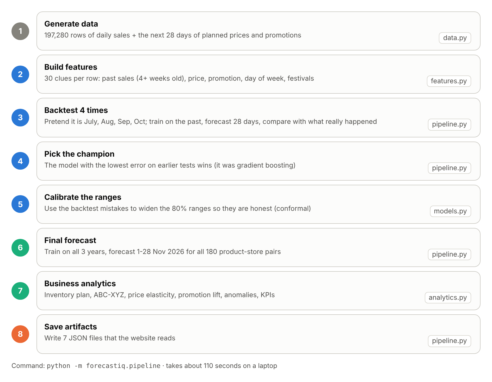

A **pipeline** is a fixed series of steps where each step's output is the next step's input, so the whole process can be re-run with one command:

```bash
python -m forecastiq.pipeline
```

It takes about **110 seconds** on a normal computer (most of it is training gradient boosting 5 times: 4 backtest folds + the final model) and prints its progress:

```
[   0.6s] data: 197,280 rows, 180 series, 2023-11-01..2026-10-31
[   1.1s] features: 30 columns
[  20.1s] fold 0: cutoff 2026-07-11  WAPE gbm=0.248 ets=0.310 snaive=0.388 ...
...
[  76.7s] champion: gbm
[ 100.5s] final forecast done
[ 107.3s] analytics done; anomaly precision=0.64 recall=0.72
[ 108.5s] artifacts written to .../artifacts
```

## What it produces (the artifacts)

| File | Size | What's inside | Used by page |
|---|---|---|---|
| `meta.json` | 3 KB | dates, stores, categories, products, festivals in the horizon, assumptions | every page |
| `overview.json` | 5 KB | KPIs, monthly revenue by category, category/store tables, top movers | Overview |
| `performance.json` | 13 KB | leaderboard, errors by category/week/fold/level, coverage, feature importance | Model performance |
| `forecast.json` | 1.7 MB | for **every** node (total, 3 regions, 5 categories, 6 stores, 180 series): 26 weeks of history, 28-day forecast, ranges, each model's forecast, backtest | Forecast explorer, Overview chart |
| `inventory.json` | 81 KB | the replenishment plan for all 180 pairs and the ABC-XYZ matrix | Inventory planning |
| `pricing.json` | 27 KB | elasticities and promo lifts, plus the base data the simulator needs | Pricing |
| `anomalies.json` | 66 KB | scorecard, recent flagged days, monthly counts | Anomaly monitor |

The total is about 1.9 MB. These files are **committed to GitHub** together with the code, so the website works immediately after deployment without retraining.

**Why is forecast.json the biggest?** It has 195 "nodes" (1 + 3 + 5 + 6 + 180), each with about 400 numbers. Pre-computing every level means the website never has to add anything up live.

**Configuration in one place.** All the settings (horizon 28, 4 folds, 80% coverage, service levels, costs, stores, categories, festivals, random seed 42) live in `forecastiq/config.py`. Changing an experiment means changing one file. The **random seed** makes the "random" data identical every time you run it, so results are **reproducible**.


# Part 12. The backend: the "counter"

## What Flask is

**Flask** is a small Python library for building web servers. You write ordinary Python functions and attach each one to a URL with a **decorator** (the line starting with `@`):

```python
@app.get("/api/forecast")
def forecast():
    node = request.args.get("node", "total:All stores")
    if node not in STORE["forecast"]:
        return jsonify(error=f"Unknown node '{node}'."), 404
    return jsonify(STORE["forecast"][node])
```

In English: "When someone asks for `/api/forecast`, read which node they want (default: the whole company), and if we don't have it, reply with an error code 404; otherwise send back that node's data as JSON."

A function attached to a URL is called a **route** or an **endpoint**.

## What happens when the server starts

`load_artifacts()` in `app.py` reads all 7 JSON files into a Python dictionary called `STORE` in memory. It takes about **1 second**. If a file is missing, it stops with a clear message: "Missing artifacts ... Run: python -m forecastiq.pipeline".

Measured on this project: startup about 0.95 seconds, about **0.4 milliseconds** per forecast request, and about **145 MB** of memory, comfortably inside the free server's 512 MB.

## All the endpoints

| Method | URL | What it returns |
|---|---|---|
| GET | `/` | the dashboard web page itself |
| GET | `/api/health` | `{"status": "ok", ...}`: lets Render check the app is alive |
| GET | `/api/meta` | basic information + the list of all forecast nodes for the dropdowns |
| GET | `/api/overview` | KPIs and tables for the Overview page |
| GET | `/api/forecast?node=...` | one node's history, forecast and ranges |
| GET | `/api/performance` | everything for the Model performance page |
| GET | `/api/inventory` | the replenishment plan |
| GET | `/api/pricing` | elasticities and promo lifts |
| GET | `/api/anomalies` | the anomaly report |
| POST | `/api/scenario` | runs the what-if simulator **live** for the slider values you send |
| POST | `/api/forecast-upload` | forecasts a CSV file you upload, **live** |
| GET | `/api/sample.csv` | a sample CSV to try the upload feature |

**GET vs POST:** **GET** = "please give me something" (like reading). **POST** = "here is some data, please do something with it" (like submitting a form).

## The two live features

Most endpoints just hand over pre-computed results. Two actually calculate something on the server each time:

**1. The what-if simulator (`/api/scenario`).** The browser sends something like:

```json
{"category": "Apparel", "store": "all", "price_change": -0.1, "promo": true}
```

The server applies the elasticity formula to the forecast and returns the new units, revenue, margin and a 25-point curve. It **checks the input first**: the price change must be a number between -50% and +50%, otherwise it answers "400 Bad Request" with a clear message.

**2. "Forecast your data" (`/api/forecast-upload`).** A visitor uploads any CSV with dates and numbers. The server (`forecastiq/quick.py`):

1. reads it, finds the date column and the number column (it recognises names like `date`, `ds`, `sales`, `units`, `qty`),
2. works out whether it's daily, weekly or monthly,
3. fills small gaps,
4. holds back the last part of the data, fits Holt-Winters and seasonal naive on the rest, and checks which predicted the held-back part better,
5. refits the winner on everything and forecasts ahead with an approximate 80% range.

It refuses bad input politely: files over 2 MB (error **413**), more than 5,000 rows, negative values, not enough data for a seasonal model, or anything that isn't a readable CSV (error **400**). Nothing is saved on the server.

Only Holt-Winters is used here (not gradient boosting) because training gradient boosting on a visitor's request would be too slow for a tiny free server, and an uploaded file has no price or promotion columns anyway.

## HTTP status codes used

| Code | Meaning | When we send it |
|---|---|---|
| 200 | OK | everything worked |
| 400 | Bad Request | your input was invalid (bad slider value, bad CSV) |
| 404 | Not Found | unknown forecast node or no matching products |
| 413 | Payload Too Large | uploaded file is over 2 MB |
| 500 | Server Error | a bug on our side (shouldn't happen) |

## gunicorn: running Flask properly

Flask's built-in server (`python app.py`) is for testing on your own computer. On the internet you use a **production server**. We use **gunicorn**, started like this:

```
gunicorn --bind 0.0.0.0:$PORT --workers 1 --threads 4 --timeout 60 app:app
```

- `--bind 0.0.0.0:$PORT` = listen on the port number Render provides.
- `--workers 1` = one copy of the app (each copy would load the data into memory again; one is enough and saves memory).
- `--threads 4` = handle up to 4 visitors at the same moment.
- `--timeout 60` = give up on a request after 60 seconds.
- `app:app` = "in the file `app.py`, use the object called `app`".

> **Problem we faced: keeping the server small.**
> The training code imports scikit-learn, a big library. If the website imported it too, the server would need to install it and use more memory.
> **Fix:** the scikit-learn import was moved *inside* the gradient boosting class, so it's only loaded when training. The website's `requirements.txt` lists only 5 packages (flask, gunicorn, numpy, pandas, scipy). A separate `requirements-train.txt` adds scikit-learn and pytest for training and testing. We verified the website runs with scikit-learn completely blocked.

> **Problem we faced (small): the page crashed before it existed.**
> We tested the API endpoints before writing the web page, and the home page (`/`) crashed with "TemplateNotFound: index.html". Not a real bug, just order of work, but it's a good example of why every endpoint gets tested, including the home page.


# Part 13. The frontend: what the visitor sees

## The three languages of the web

- **HTML** = the structure ("there's a heading, a menu, a box here"). Our file: `templates/index.html` (45 lines). It's mostly an empty frame; JavaScript fills it in.
- **CSS** = the looks: colours, fonts, spacing, the dark theme, the phone layout. Our file: `static/styles.css`.
- **JavaScript** = the behaviour: fetching data, building tables, drawing charts, reacting to clicks. Our files: `static/app.js` (the pages) and `static/charts.js` (the charts).

## Choices we made and why

**No framework (no React, no build step).** Big websites use frameworks like React that need extra build tools. For a dashboard this size, plain JavaScript is enough, loads instantly and has nothing to install. One fewer thing to break during deployment.

**A "single-page app".** The page loads once. When you click "Inventory planning" in the menu, the address changes to `.../#inventory` and JavaScript swaps the content without reloading the page. The part after `#` (the "hash") remembers which page you're on, so you can bookmark it or press Back.

**Hand-written SVG charts.** **SVG** (Scalable Vector Graphics) describes pictures as shapes: "draw a line from here to here", "a rectangle there". It stays sharp at any zoom. `charts.js` (168 lines) draws two chart types: a **line chart** (with shaded ranges, hover crosshair and tooltips) and a **bar chart** (grouped or stacked). We built them by hand because no chart library was available, and it keeps the site tiny.

**Colours with meaning.** The colours come from a palette tested for colour-blind visitors. Status colours (red Critical, orange Reorder, yellow Overstock, green Healthy) always come with a text label, never colour alone.

**Light and dark theme.** It follows your computer's setting, and the "Switch theme" button flips it. All colours are defined as CSS variables in one place, so switching theme just swaps that list.

**Works on phones.** Below 980 pixels wide, the menu moves to a scrollable bar on top and the panels stack in one column.

**Indian number format.** Numbers use the Indian system (2,32,832), and money is shown as ₹13.87 Cr or ₹66.9 L.

## Tour of the eight pages

### Page 1: Overview

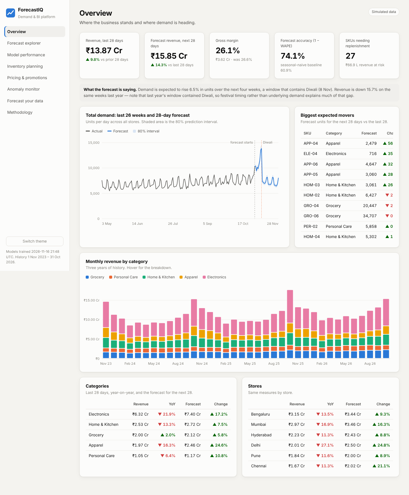

- **KPI tiles** on top: the five numbers a manager wants first, each with a comparison (▲/▼).
- **"What the forecast is saying"**: a sentence generated automatically from the numbers, including the festival-timing explanation.
- **Total demand chart**: last 26 weeks (grey) + forecast (blue) + 80% range (shaded), with "forecast starts" and "Diwali" markers. Hover to see each day's values.
- **Biggest expected movers**: products whose forecast changes most against the last 4 weeks.
- **Monthly revenue by category**: 3 years of stacked bars. You can see the yearly Diwali peaks.
- **Category and store tables**: revenue, change vs last year, forecast, expected change.

### Page 2: Forecast explorer

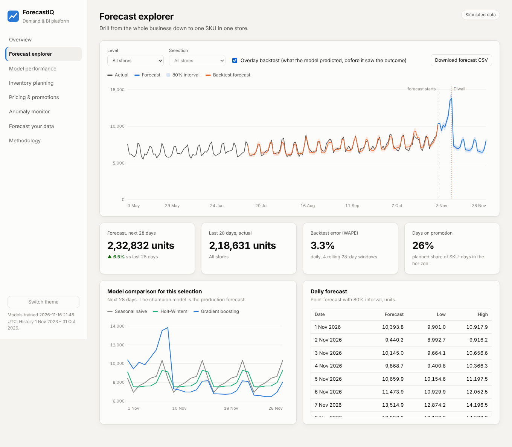

Choose a **level** (all stores, region, category, store, or one product in one store) and a **selection**. The chart shows history, forecast and range. Tick **"Overlay backtest"** to see, in orange, what the model predicted during the test months **before** it saw the actual sales: the best visual proof that the model works. Also: KPIs, a comparison of all three models' forecasts, a daily table and a **Download forecast CSV** button.

### Page 3: Model performance

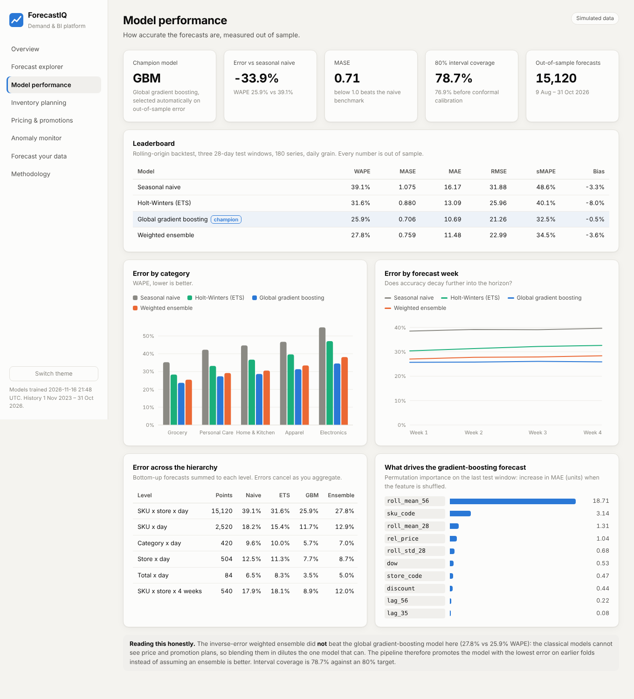

The **leaderboard** (Part 8), error by category (bars), error by forecast week (flat lines, explained in Part 8), error across the hierarchy, the feature importance bars, and an honest note on why the ensemble lost.

### Page 4: Inventory planning

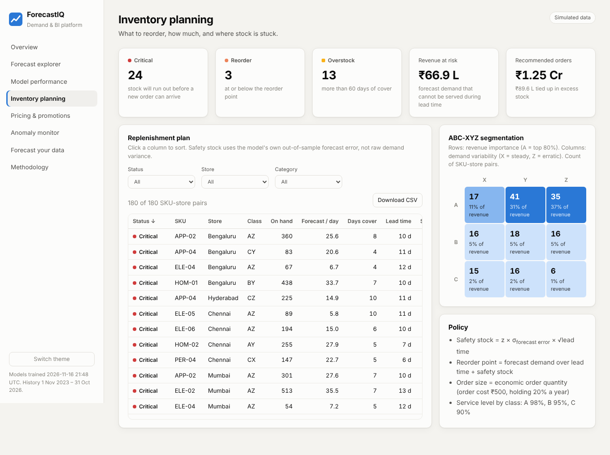

Status counts, the full **replenishment plan** (sortable by clicking column headers, filterable by status, store, category, downloadable as CSV), the **ABC-XYZ matrix** (darker = more revenue) and the policy formulas.

### Page 5: Pricing & promotions

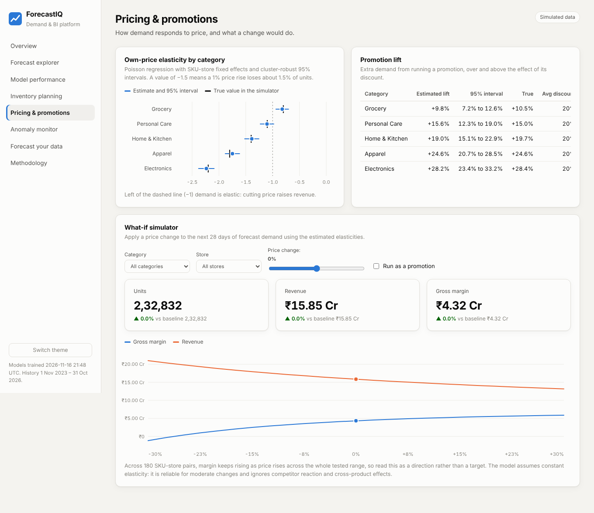

The **elasticity chart** (dot = estimate, line = 95% range, black tick = the true value), the **promotion lift** table, and the **what-if simulator** with its slider and revenue/margin curve.

### Page 6: Anomaly monitor

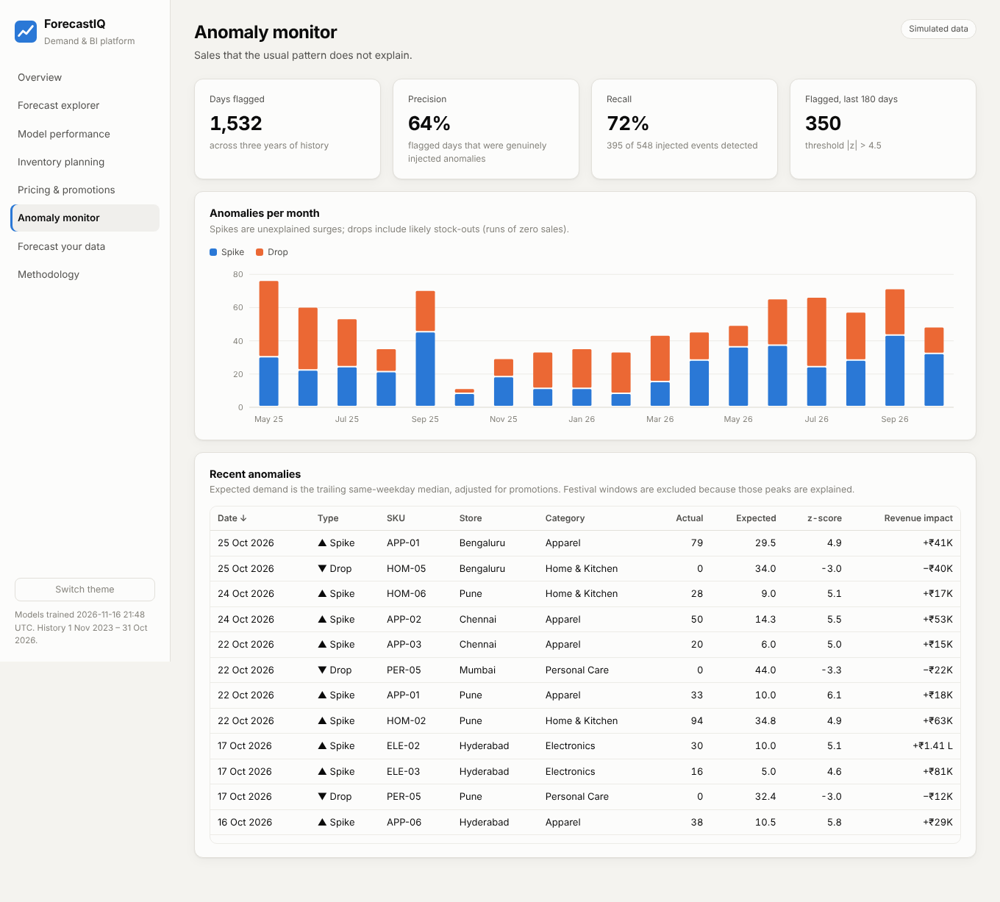

Detector scorecard (precision, recall), anomalies per month split into spikes and drops, and a table of recent anomalies with expected vs actual sales, z-score and revenue impact.

### Page 7: Forecast your data

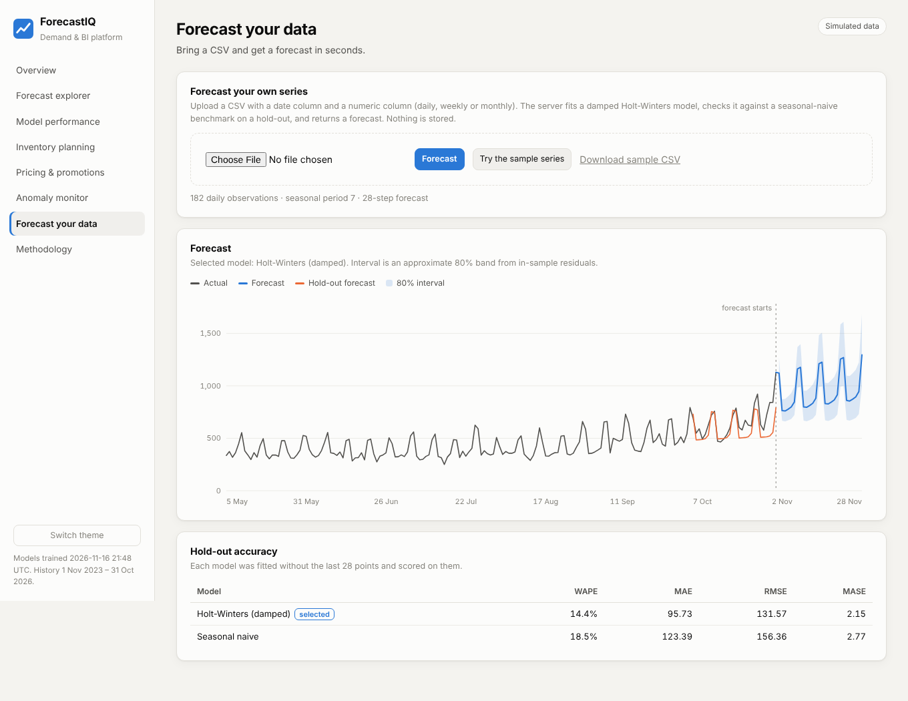

Upload a CSV (or click "Try the sample series") and get a forecast, a hold-out comparison of two models, and accuracy scores. This is the most "interactive" feature for a recruiter to play with.

### Page 8: Methodology

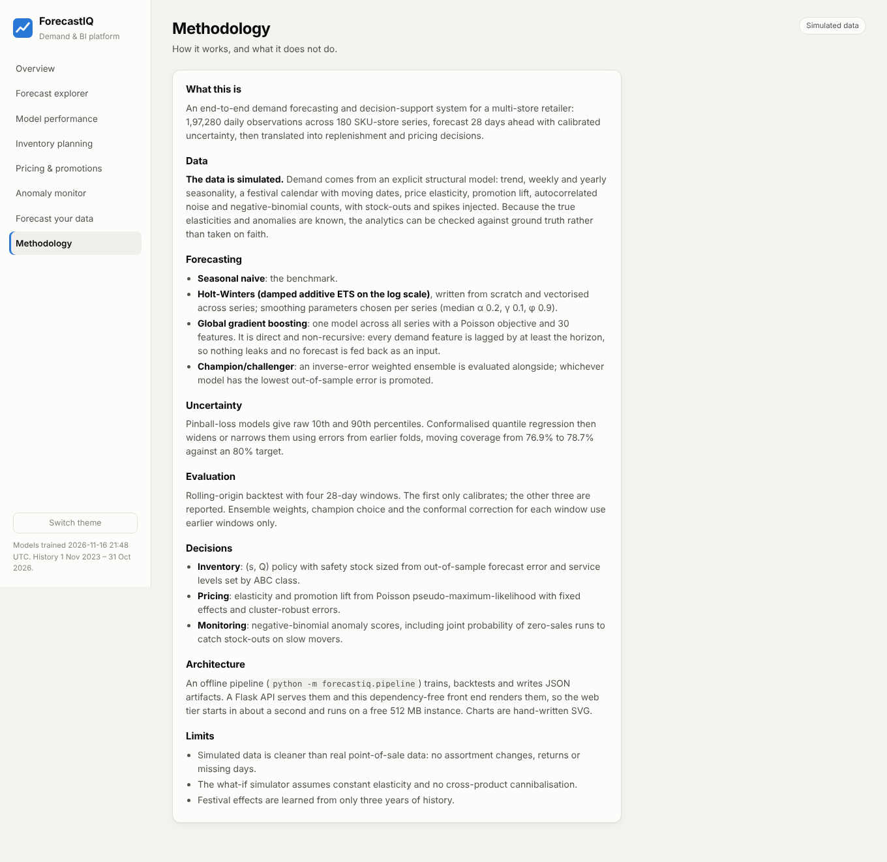

A written summary of the method and its limits, inside the app, for visitors who want details.

> **Problems we faced: the first version of the pages had layout bugs.**
> After building the pages we opened every one in a real (automated) browser and took screenshots in light mode, dark mode and phone width, then looked at them. We found and fixed:
> - the "forecast →" and "Diwali" labels on the main chart were printed **on top of each other**;
> - some tables were **cut off** on the right (the promotion table's last column, the hierarchy table's headers);
> - the "Champion model" tile showed "Global gradient boosting" in huge letters over three lines; it now says "GBM" with the full name below;
> - on phone-sized screens the whole page was **wider than the screen** (a CSS grid quirk), so you had to scroll sideways;
> - the model comparison legend showed internal code names ("snaive", "gbm") instead of readable names;
> - the misleading "margin peak at +30%" message (Part 10.5).
>
> **Lesson:** always look at your app on different screens, not just check that the code runs. There were zero JavaScript errors in the browser console on any page after the fixes.


# Part 14. How the pieces talk to each other

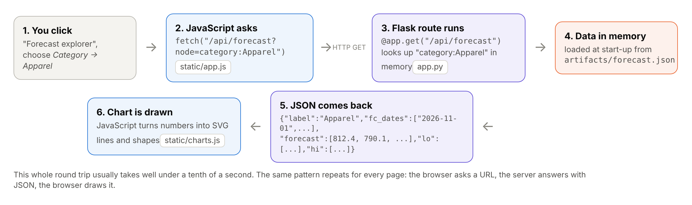

Let's follow one click from start to finish. You're on the Forecast explorer and choose **Category → Apparel**.

1. **The browser (frontend)** notices the dropdown changed. The `draw()` function in `static/app.js` runs.
2. It calls `fetch("/api/forecast?node=category:Apparel")`. `fetch` is the JavaScript command for "ask the server for this URL". The part after `?` is a **query parameter**: extra information for the server.
3. The request travels over the internet using **HTTP** (the language browsers and servers speak; **HTTPS** is the encrypted version, which Render provides automatically).
4. **gunicorn** on the server receives it and hands it to **Flask**.
5. Flask finds the route `@app.get("/api/forecast")` and runs the `forecast()` function.
6. The function looks up `"category:Apparel"` in the `STORE` dictionary that was loaded from `forecast.json` at startup.
7. It sends the data back as **JSON** with status **200 OK**.
8. Back in the browser, `app.js` receives the JSON, saves a copy (a **cache**: if you pick Apparel again, it won't ask the server again), and passes the numbers to `Charts.line(...)` in `charts.js`.
9. `charts.js` converts numbers into positions on the screen and builds the SVG: the grey history line, the blue forecast line, the shaded range, the axes and the hover areas.
10. You see the chart, usually in a small fraction of a second.

**Everything on the website follows this same pattern:** frontend asks → backend looks up or calculates → JSON comes back → frontend draws. Once you understand this one journey, you understand how every page works.

**Where does the pipeline fit in?** It isn't part of this journey at all. It ran **earlier**, on a computer, and its only connection to the website is the JSON files it left in `artifacts/`. This separation is a common real-world pattern called **batch scoring** or **offline inference**: predictions are computed in a batch on a schedule, and the app serves them.


# Part 15. Automatic tests and CI

## What tests are

A **test** is a small piece of code that checks other code does what it should. Instead of opening the website and clicking around after every change, you run one command:

```bash
pytest -q
```

and 32 checks run in about 10 seconds. `32 passed` means everything still works. **pytest** is the standard Python testing tool.

## Our 32 tests

**Model tests** (`tests/test_models.py`):

- seasonal naive repeats the last week correctly;
- Holt-Winters forecasts a trending seasonal pattern with under 8% error and beats the naive method;
- Holt-Winters picks its settings from the allowed grid for each series;
- the error metrics give the right answers on a hand-calculated example;
- conformal calibration turns deliberately too-narrow ranges into ranges that cover 77-83% of new data;
- ensemble weights add up to 1 and favour the more accurate model.

**Pipeline tests** (`tests/test_pipeline_parts.py`):

- the data generator produces exactly the right number of rows, no negative sales, and the same data every time (reproducibility);
- **no leakage** (Part 6);
- the elasticity analysis recovers every category's true value within 0.15, and the promo lift within 5 points;
- the anomaly detector finds over 60% of events with over 50% precision, flagging less than 2% of days;
- ABC classes follow revenue (every A earns more than every B, and so on);
- the what-if simulator moves in the right direction (cutting price raises units, etc.).

**API tests** (`tests/test_api.py`):

- every page and endpoint answers 200;
- **forecasts add up**: the 5 category forecasts sum to the total forecast; every forecast lies inside its range;
- the champion beats the naive benchmark by over 20%, MASE under 1, coverage 70-90%;
- the simulator rejects bad input (400) and unknown categories (404);
- CSV upload works for daily, weekly and monthly data, and rejects empty files, too-short files, negative values and garbage.

Tests like "the champion must beat the benchmark" are **guard-rails**: if a future change makes the model worse, the test fails before anyone sees a bad website.

## CI: tests that run themselves

**CI (Continuous Integration)** means the tests run automatically on a remote computer every time code is pushed to GitHub. We set it up with **GitHub Actions** in a file called `ci.yml`: "on every push, install Python 3.13 and the requirements, then run pytest". GitHub then shows a green tick (passed) or red cross (failed) next to every change. Recruiters notice that green tick.

> **Problem we faced: the CI file couldn't be put in its proper folder.**
> GitHub only runs CI files that sit in `.github/workflows/`. When we copied the project to your Mac, that folder was protected and couldn't be written, so `ci.yml` landed in the main project folder instead. It does nothing there.
> **Fix (your job, 10 seconds):** in Terminal, inside the project folder:
>
> ```bash
> mkdir -p .github/workflows
> mv ci.yml .github/workflows/ci.yml
> ```
>
> Folders starting with a dot are hidden in Finder (press `Cmd + Shift + .` to show them). If you upload to GitHub by drag-and-drop in the browser instead of using Terminal, you can create the file directly on GitHub: **Add file → Create new file**, type the name `.github/workflows/ci.yml`, and paste the contents of `ci.yml`.


# Part 16. Deployment: putting it on the internet

## What "deploying" means

Right now the project lives in a folder on your Mac. Only you can see it, and only when your Mac is on. **Deploying** means copying it onto a server that is always on and connected to the internet, so anyone with the link can use it, any time.

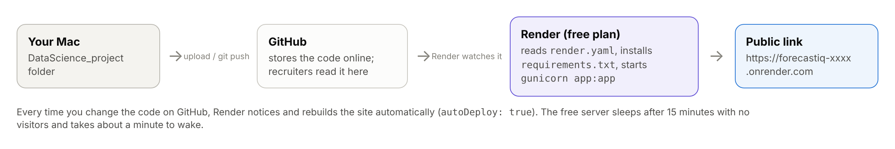

The chain is:

1. **Your Mac** → upload the code to **GitHub** (online code storage; also your public portfolio of code).
2. **Render** (a hosting company) is connected to your GitHub. It copies the code, installs the requirements, and starts the app.
3. Render gives you a public link like `https://forecastiq-xxxx.onrender.com`.
4. Whenever you update the code on GitHub, Render **automatically** rebuilds the site.

## The deployment files and what each one is for

| File | Who reads it | What it says |
|---|---|---|
| `requirements.txt` | Render (and you) | The 5 Python packages the **website** needs, with exact versions: flask, gunicorn, numpy, pandas, scipy |
| `requirements-train.txt` | You / GitHub Actions | Everything above **plus** scikit-learn and pytest, for training and testing |
| `render.yaml` | Render | A "blueprint": one free web service called `forecastiq`, how to build it (`pip install -r requirements.txt`), how to start it (the gunicorn command), the health-check URL (`/api/health`), auto-deploy on, Python version 3.13.5 |
| `Procfile` | Other hosts (Railway, Heroku-style) | The start command, one line |
| `Dockerfile` | Any Docker host | A recipe for a self-contained box: start from Python 3.13, install requirements, copy the app, run as a normal (non-admin) user, start gunicorn on port 7860 |
| `.dockerignore` | Docker | Files to leave out of the box (tests, docs, git history) to keep it small |
| `.gitignore` | Git | Files never to upload (Python cache files, your local `.venv` folder, Mac `.DS_Store` files, secret `.env` files) |

**What is Docker, in one paragraph?** Software often works on one computer and fails on another because of different versions of things. **Docker** packages the app together with exactly the right operating-system pieces, Python version and libraries into a **container**: a sealed box that runs the same everywhere. We included a `Dockerfile` as a backup so the app can move to any container host. Render doesn't need it because `render.yaml` uses Render's own Python environment.

## Why Render, and what we considered

| Platform | Verdict |
|---|---|
| **Render (free web service)** | **Chosen.** Runs any Python web app, connects to GitHub, free plan with 512 MB memory and 0.1 CPU, HTTPS included. |
| Hugging Face Spaces | Popular for ML demos, but recent forum reports say Docker Spaces now need a paid plan for new accounts. |
| Streamlit Community Cloud | Only runs Streamlit apps. Ours is Flask with a custom frontend. |
| Railway, Fly.io | Free allowances are small or trial-based and change often. |
| Vercel, Netlify, GitHub Pages | Great for static websites, but our app needs a Python server for the live simulator and CSV upload. |

## The free plan's limits (important)

- **It sleeps.** After **15 minutes** with no visitors, Render pauses the app. The next visitor waits **about a minute** while it wakes up (a **cold start**). After that it's fast again.
- **512 MB memory, 0.1 CPU.** That's very small, which is exactly why we moved all the heavy work to the offline pipeline. Our app uses about 145 MB.
- **750 free hours a month** per account, enough for one app running all month.

**Practical tip:** before an interview or when you send the link to someone, open it yourself 2 minutes earlier so it's awake.

## Problems we faced (and expect) at deployment

> **1. We could not deploy it for you automatically.**
> Deployment needs **your** GitHub and Render accounts and passwords, which only you can create and sign in to. So the project was built and tested to be deployment-ready, with step-by-step instructions, and the final clicks are yours (or can be done together in your browser while you sign in).

> **2. The production server was not tested on the build computer.**
> gunicorn wasn't installed there, so the app was tested with Flask's built-in server and with an automated browser instead. gunicorn runs the same Flask app, so this is a small risk, but if the first Render deploy fails, the log will say why. The start command is the standard one.

> **3. Python version requirements.**
> The package versions require **Python 3.11 or newer** (pandas 3.0 needs it). Macs often come with an older Python 3.9. On Render this doesn't matter (`render.yaml` asks for 3.13.5), but to run it on your Mac you may need to install a newer Python from python.org.

> **4. Cold starts.**
> The free plan's sleep is a limit of the platform, not a bug. The fixes are: open the link early, or pay about $7 a month for an always-on instance.

> **5. The hidden CI file** (Part 15).

> **6. GitHub passwords don't work in Terminal.**
> When pushing code with `git push`, GitHub no longer accepts your account password. You need a **personal access token** (a long generated password), with the **repo** and **workflow** permissions (workflow is needed because the project contains a CI file). Uploading by drag-and-drop on the GitHub website avoids this.

## Deployment, step by step (short version)

1. Create free accounts on **github.com** and **render.com** (sign in to Render with GitHub).
2. On GitHub: **+ → New repository**, name `demand-forecasting-bi-platform`, Public, nothing ticked, **Create**.
3. Upload the project: either click "uploading an existing file" and drag all files from the DataScience_project folder in (use Chrome), or use `git` commands in Terminal.
4. On Render: **New + → Blueprint**, pick the repository, **Apply**. Wait 3-6 minutes until it says **Live**.
5. Open the link. Check `/api/health` says `"status":"ok"`.
6. Put the link in `README.md`, on your resume and in your portfolio.

**If the Blueprint option fails:** **New + → Web Service**, choose the repository, build command `pip install -r requirements.txt`, start command `gunicorn --bind 0.0.0.0:$PORT --workers 1 --threads 4 --timeout 60 app:app`, instance type **Free**.

## Troubleshooting

| What you see | Likely cause | Fix |
|---|---|---|
| Render build fails at `pip install` | wrong Python version or a typo in requirements | check the log; `PYTHON_VERSION` should be 3.13.5 |
| "Missing artifacts" in the log | the `artifacts/` folder wasn't uploaded | upload the 7 JSON files to GitHub |
| Page loads but says "Could not load this page" | an API endpoint failed | open `/api/health` and the Render logs |
| "Service Unavailable" / long wait | the app is waking up | wait about 60 seconds and refresh |
| GitHub Actions shows a red cross | a test failed or the CI file is in the wrong place | open the Actions tab and read the failing step |
| `git push`: "Authentication failed" | used your password | use a personal access token |


# Part 17. Every file, explained

```
DataScience_project/
├── app.py                    the web server (Flask): all API endpoints        134 lines
├── forecastiq/               the data science package
│   ├── __init__.py           marks the folder as a package; version number      3
│   ├── config.py             every setting: horizon, stores, categories,       60
│   │                         festivals, costs, service levels, random seed
│   ├── data.py               the simulator that makes the sales data          175
│   ├── features.py           the 30 leakage-safe features                      76
│   ├── models.py             seasonal naive, Holt-Winters, gradient boosting, 136
│   │                         conformal calibration, ensemble weights
│   ├── evaluation.py         error metrics: WAPE, MAE, RMSE, MASE, bias ...    55
│   ├── analytics.py          KPIs, ABC-XYZ, inventory, elasticity,            299
│   │                         anomalies, what-if simulator
│   ├── pipeline.py           runs everything in order, writes artifacts       344
│   └── quick.py              forecasts uploaded CSV files                      96
├── artifacts/                the 7 JSON result files (1.9 MB)
├── templates/index.html      the page frame                                    45
├── static/
│   ├── app.js                the 8 pages and their behaviour                  510
│   ├── charts.js             hand-made line and bar charts                    168
│   └── styles.css            colours, layout, dark theme, phone layout        122
├── tests/                    32 automatic tests                              217
├── docs/                     screenshots used by the README and this guide
├── README.md                 the project's front page on GitHub
├── RESUME_NOTES.md           resume bullets and interview questions
├── PROJECT_GUIDE.md / .pdf   this guide
├── requirements.txt          packages the website needs
├── requirements-train.txt    + packages for training and tests
├── render.yaml               Render deployment blueprint
├── Procfile                  start command for other hosts
├── Dockerfile                container recipe
├── ci.yml                    GitHub Actions tests (move to .github/workflows/)
└── .gitignore, .dockerignore files to leave out
```

In total about **2,400 lines** of code: roughly 1,380 lines of Python data science and server code, 850 lines of frontend, and 220 lines of tests.

**Where to look when someone asks "show me the code for X":**

| Question | File and function |
|---|---|
| "How is the data generated?" | `data.py` → `generate()` |
| "Show me your features" | `features.py` → `build_features()` |
| "Show me Holt-Winters" | `models.py` → `class HoltWinters` |
| "How do you train the ML model?" | `models.py` → `class GlobalGBM` |
| "How do you evaluate?" | `pipeline.py` → `backtest()`, `evaluation.py` |
| "How do you pick the final model?" | `pipeline.py` → `pick_champion()` |
| "How are intervals calibrated?" | `models.py` → `conformal_scores()`, `conformal_quantile()`; `pipeline.py` → `finalise()` |
| "How is safety stock calculated?" | `analytics.py` → `inventory_policy()` |
| "How is elasticity estimated?" | `analytics.py` → `_ppml()`, `price_response()` |
| "How do you detect anomalies?" | `analytics.py` → `detect_anomalies()` |
| "What does the API look like?" | `app.py` |
| "How are charts drawn?" | `static/charts.js` |


# Part 18. How to change things

**Run everything from scratch** (Terminal, inside the folder, after installing `requirements-train.txt`):

```bash
python -m forecastiq.pipeline     # retrain, about 2 minutes, rewrites artifacts/
pytest -q                         # check everything still works
python app.py                     # view at http://localhost:7860
```

Then upload the changed files to GitHub; Render redeploys automatically.

**Common changes:**

| I want to... | Change this |
|---|---|
| forecast 14 days instead of 28 | `HORIZON = 14` in `config.py` |
| add a store | add a line to `STORES` in `config.py` |
| change service levels or costs | `SERVICE_LEVEL`, `ORDER_COST`, `HOLDING_RATE` in `config.py` |
| add a festival | add it to `HOLIDAYS` in `config.py` |
| get different random data | change `SEED` in `config.py` |
| use **real** data | replace `generate()` in `data.py` with code that loads your CSV into the same columns (`date, store_id, sku_id, category, units, price, list_price, promo, discount, unit_cost`) plus the future price/promo plan. The rest of the pipeline stays the same. Ground-truth checks (true elasticity etc.) will then not exist. |

**Good public datasets to try:** M5 (Walmart, Kaggle), Corporación Favorita (Kaggle), Rossmann Store Sales (Kaggle).


# Part 19. Honest limitations and what could come next

Every project has limits. Knowing yours, and saying them before someone else does, is a sign of maturity.

## Limitations

1. **Simulated data.** Real data has missing days, products being added and removed, returns, supply problems, competitor actions and data errors that our simulator doesn't have.
2. **Stock-outs hide real demand.** When a shelf is empty, recorded sales are zero, but customers wanted to buy. We detect these days but don't correct the training data for them ("censored demand").
3. **The festival effect is learned from 3 Diwalis.** That's very few examples.
4. **The what-if simulator is simple.** Constant elasticity, no competitor reaction, no customers switching between products ("cannibalisation").
5. **Interval coverage 78.7%** is slightly under the 80% target.
6. **The anomaly threshold was tuned on the same data it's scored on** (Part 10.6).
7. **The model can't react to last week** (newest sales clue is 28 days old, Part 6).
8. **The free hosting sleeps** after 15 minutes.
9. **No automatic retraining.** Someone has to run the pipeline to refresh the forecasts.

## Natural next steps

- Run it on a real public dataset (M5 / Favorita).
- **Hierarchical reconciliation** (e.g. MinT): combine forecasts from all levels instead of plain bottom-up.
- Special methods for slow, intermittent sellers (Croston, TSB).
- Short-horizon models for days 1-7 that use last week's sales.
- Correct training data for stock-out days.
- A scheduled GitHub Action that retrains weekly and commits fresh artifacts.
- **Drift monitoring:** alert when the model's error starts rising.
- A PostgreSQL database if real daily data and user logins are added.


# Part 20. Explaining it in an interview

## The 30-second version

> "I built a demand forecasting and BI platform for a simulated retail chain: 6 stores, 30 products, 3 years of daily sales. A global gradient-boosting model forecasts 28 days ahead and cut error by 34% compared with a seasonal-naive benchmark in a rolling backtest. Conformal calibration gives prediction intervals with about 79% coverage against an 80% target. The forecasts then drive an inventory plan with safety stock and reorder points, a price-elasticity analysis, and anomaly detection, all served by a Flask API to a custom dashboard deployed on Render."

## The 2-minute version (structure)

1. **Problem:** retailers lose money both by running out and by overstocking; they need daily forecasts per product per store, with uncertainty.
2. **Data:** simulated with a structural model (trend, seasonality, festivals, price, promotions, noise), deliberately, so I could validate the analytics against known ground truth.
3. **Models:** seasonal naive benchmark, Holt-Winters I implemented myself, a global gradient boosting model (scikit-learn) with leakage-safe features, and a weighted ensemble; champion chosen automatically.
4. **Evaluation:** rolling-origin backtest, WAPE and MASE, results across the hierarchy; the ensemble lost and I explain why.
5. **Uncertainty:** quantile models + conformalised quantile regression.
6. **Decisions:** safety stock from forecast error, ABC-XYZ, PPML elasticities within 0.05 of truth, anomaly detection with precision/recall.
7. **Engineering:** offline pipeline → JSON artifacts → Flask API → vanilla JS dashboard; 32 tests, CI, free deployment.

## Questions you should be ready for

**"Is this real data?"**
No, it's simulated, deliberately. Real store-level data is private, and simulation gave me ground truth to validate the elasticity and anomaly modules, which you can't do with real data. The pipeline only needs one module replaced to run on real data.

**"Why did the ensemble lose?"**
Two of its three members can't see price, promotions or festivals. Mixing them in dilutes the one model that can. Ensembles help when members are similarly good and make different errors. So I added champion/challenger selection instead of assuming.

**"How do you know there's no leakage?"**
All sales-derived features are lagged at least the 28-day horizon; ensemble weights, champion choice and conformal correction for each fold use only earlier folds; and a test overwrites the last 27 days of sales and checks the forecast features don't change.

**"Why WAPE and MASE instead of MAPE?"**
MAPE is undefined at zero sales and explodes for slow movers. WAPE weights by volume; MASE compares against a naive benchmark and is scale-free.

**"Why gradient boosting and not deep learning (LSTM, Transformer)?"**
For tabular data with strong known drivers like price, promotions and calendar, gradient boosting is usually as accurate or better, much faster to train, easier to explain and cheaper to run. Most top solutions in the M5 forecasting competition were gradient boosting models (LightGBM). Deep learning would make sense with much more data or many related signals.

**"Why one global model?"**
It learns shared patterns across 180 series, which especially helps slow sellers with little data, and there's one model to maintain instead of 180.

**"What is conformal prediction?"**
A way to calibrate prediction intervals using past errors: measure how far outside the ranges past values fell, widen future ranges by the amount that would have achieved 80%. It's distribution-free but assumes the future resembles the calibration period, which is why coverage is 78.7% rather than exactly 80%.

**"Why Poisson regression for elasticity?"**
Sales are counts with zeros; log-OLS can't handle zeros and is biased under heteroskedasticity. PPML is consistent. Fixed effects compare a product only with itself; cluster-robust errors handle day-to-day correlation.

**"Why safety stock from forecast error, not demand variance?"**
The forecast already expects weekends, promotions and Diwali. The cushion only needs to cover what the forecast gets wrong, so using forecast error avoids holding stock for predictable swings.

**"Why 25.9% error? Isn't that high?"**
At product-store-day level much of what's left is irreducible noise. The same forecasts have 11.7% error at product-day, 3.5% at total-day, and 8.9% for product-store four-week totals, which is what purchasing actually uses.

**"Why no database?"**
The app is read-only and the data changes only when the pipeline runs, so JSON artifacts in memory are faster, simpler and free. With real daily data or user accounts I'd add PostgreSQL.

**"What was the hardest part?"**
Pick one honest story: the ensemble losing and changing the design to champion/challenger, or the anomaly detector going from 21% precision to 64% by switching to a count-aware model.

**"What would you do next?"**
Run on M5 data, hierarchical reconciliation, intermittent-demand methods, scheduled retraining with drift monitoring.

## Words of caution

- Don't claim the data is real.
- Don't claim you used LightGBM, Prophet or statsmodels; you used scikit-learn's HistGradientBoosting and your own Holt-Winters.
- Don't claim 80% coverage; it's 78.7%.
- Don't claim the anomaly numbers are fully independent; the threshold was tuned on the same data.
- Do know every number on your resume and where it comes from (Appendix B).


# Appendix A. Glossary

**ABC analysis**: grouping products by revenue: A (top 80%), B (next 15%), C (last 5%).

**API**: a set of URLs a server offers so other programs (like our frontend) can request data.

**AR(1) / autocorrelation**: when today's value is related to yesterday's; "sticky" randomness.

**Artifact**: a file produced by a training run (our 7 JSON files).

**Backend**: code running on the server (`app.py`).

**Backtest**: testing a forecasting method on past periods as if it were used at the time.

**Benchmark / baseline**: a simple method that any serious model must beat (seasonal naive).

**Bias (forecast)**: whether forecasts are systematically too high or too low.

**Bottom-up**: forecasting the detailed level and adding up for higher levels.

**Cache**: a saved copy of data to avoid asking for it again.

**Champion/challenger**: keep the best-performing model as the "champion", track others as "challengers", and swap if one becomes better.

**CI (Continuous Integration)**: tests run automatically on every code change.

**Cluster-robust standard errors**: uncertainty estimates that account for related observations (same product over time).

**Coefficient of variation (CV)**: standard deviation ÷ mean; how jumpy something is relative to its size.

**Cold start**: the delay when a sleeping free server wakes up.

**Confounding**: when a hidden third factor makes two things look related (Diwali causes both promotions and high sales).

**Conformal prediction / CQR**: calibrating prediction intervals using past errors so they reach the target coverage.

**Container / Docker**: a sealed package with an app and everything it needs, which runs the same everywhere.

**Coverage**: the share of actual values that fall inside the prediction intervals.

**CSS**: the language for a web page's appearance.

**CSV**: a plain-text table where values are separated by commas.

**Damped trend**: a trend that fades out over the forecast horizon instead of continuing forever.

**Decision tree**: a model that predicts by asking a series of yes/no questions.

**Decorator**: a line starting with `@` above a Python function, e.g. `@app.get(...)`, that attaches it to a URL.

**Deployment**: putting software on a server so others can use it.

**Direct forecasting**: predicting each future day from known data only, without feeding forecasts back in.

**Elasticity (price)**: % change in sales for a 1% change in price.

**Endpoint / route**: one URL the server answers, linked to one function.

**Ensemble**: combining several models' predictions.

**EOQ (Economic Order Quantity)**: the order size that balances ordering cost and holding cost.

**Feature / feature engineering**: an input column for the model / the work of creating them.

**Fixed effects**: a separate baseline per group (product-store) in a regression.

**Flask**: a Python library for building web servers.

**Frontend**: code running in the visitor's browser (HTML, CSS, JavaScript).

**Global model**: one model trained on all series together.

**Gradient boosting**: many small decision trees built one after another, each fixing the previous ones' mistakes.

**Ground truth**: the known true answer, used to check an analysis.

**gunicorn**: a production server program that runs Flask apps on the internet.

**Hierarchy**: levels of aggregation (product-store → store → region → total).

**Holding cost**: the cost of keeping stock (money tied up, storage, spoilage).

**Holt-Winters / exponential smoothing**: a classical forecasting method tracking level, trend and season.

**Horizon**: how far ahead you forecast (28 days).

**HTML**: the language for a web page's structure.

**HTTP / HTTPS**: the protocol browsers and servers use to talk; HTTPS is the encrypted version.

**IRLS**: Iteratively Reweighted Least Squares, the algorithm we use to fit the Poisson regression.

**JavaScript**: the programming language that runs in browsers.

**JSON**: a simple text format for structured data.

**KPI**: Key Performance Indicator, a headline business number.

**Lag**: a past value of a series (lag 28 = value 28 days ago).

**Lead time**: days between placing an order and receiving it.

**Leakage**: accidentally using information that wouldn't be available at prediction time.

**MAE, RMSE, WAPE, MASE, sMAPE**: error metrics (see Part 8).

**Median**: the middle value when sorted; unaffected by a few extreme values.

**Negative binomial**: a probability distribution for counts that vary more than a simple Poisson model allows.

**Overfitting**: memorising training data instead of learning general patterns.

**Pinball loss / quantile loss**: the loss used to train a model to predict a percentile.

**Pipeline**: a fixed sequence of processing steps that can be re-run with one command.

**Poisson loss / regression**: methods designed for count data.

**Precision / recall**: share of alarms that are real / share of real events that raised an alarm.

**Prediction interval**: a range expected to contain the actual value with a stated probability.

**pytest**: the standard Python testing tool.

**Query parameter**: extra information in a URL after `?`, like `?node=category:Apparel`.

**Random seed**: a number that makes "random" results repeat identically.

**Reorder point**: the stock level at which you place a new order.

**Rolling mean**: the average over a moving window of days.

**Rolling-origin evaluation**: repeated backtests with the "today" point moving forward.

**Seasonality**: patterns repeating on a fixed cycle.

**Server**: an always-on computer that answers requests over the internet.

**Service level**: the target probability of not running out of stock during a lead time.

**Safety stock**: extra stock held to protect against forecast errors.

**Single-page app**: a website that loads once and swaps content with JavaScript.

**SKU**: Stock Keeping Unit, a code for one specific product.

**SVG**: a format for drawing pictures as shapes; used for our charts.

**Time series**: values recorded in time order.

**Vectorised**: doing a calculation on whole arrays at once instead of looping, which is much faster.

**XYZ analysis**: grouping products by how predictable their demand is.

**z-score**: how many "typical deviations" a value is from what was expected.


# Appendix B. The numbers cheat sheet

| What | Number |
|---|---|
| Stores / products / categories / series | 6 / 30 / 5 / 180 |
| History | 1 Nov 2023 - 31 Oct 2026 (1,096 days) |
| Rows of data | 197,280 (+ 5,040 future rows) |
| Forecast window | 1 - 28 Nov 2026 (28 days) |
| Features | 30 |
| Backtest folds | 4 (1 calibration + 3 reported), 15,120 reported forecasts |
| Champion WAPE / benchmark WAPE | 25.9% / 39.1% (34% less error) |
| Champion MASE | 0.706 |
| Champion bias | -0.5% |
| Holt-Winters WAPE | 31.6% |
| Ensemble WAPE | 27.8% |
| WAPE at company-day level | 3.5% |
| WAPE at product-store 4-week level | 8.9% |
| Interval coverage (target 80%) | 76.9% raw → 78.7% calibrated |
| Elasticity error vs truth | ≤ 0.05 in all 5 categories |
| Anomalies planted / found | 548 / 395 (recall 72%), precision 64% |
| Inventory status | 24 Critical, 3 Reorder, 13 Overstock, 140 Healthy |
| Recommended orders / revenue at risk | ₹1.25 Cr / ₹66.9 L |
| Pipeline run time | about 110 seconds |
| Artifacts size | 1.9 MB (7 files) |
| Web app memory / startup | about 145 MB / about 1 second |
| Automatic tests | 32 |
| Lines of code | about 2,400 |


# Appendix C. Every problem we faced, in one table

| # | Stage | Problem | What we did |
|---|---|---|---|
| 1 | Data | No real data available and no internet to download any | Wrote a structural simulator with known ground truth |
| 2 | Tools | statsmodels, LightGBM, Prophet, Streamlit, Plotly not installed; no internet to install | Implemented Holt-Winters ourselves, used scikit-learn gradient boosting, hand-built SVG charts and a Flask app |
| 3 | Data | Electronics made 6-10× the revenue of every other category, hiding them in charts | Narrowed Electronics prices to ₹1,500-12,000 |
| 4 | Data | Simulated stock levels made 50 of 180 pairs "Critical" | Raised typical stock cover from ~16 to ~26 days (honest: tuned for a realistic demo) |
| 5 | Models | Weighted ensemble was worse than gradient boosting alone (27.8% vs 25.9%) | Tested 7 variants; none won; added champion/challenger selection |
| 6 | Intervals | Raw 80% ranges covered only 73.7% (first version), then 76.9% | Conformalised quantile regression; final 78.7% (slightly under target, reported honestly) |
| 7 | Anomalies | First detector: 21% precision, 44% recall | Rewrote with count-aware noise, promo adjustment and zero-run test; 64% / 72% |
| 8 | Anomalies | Threshold chosen while looking at the truth | Disclosed as a limitation |
| 9 | Pricing | Simulator said "best margin at +30%", the edge of the range | Changed the message to "direction, not target" and hid the false peak marker |
| 10 | Backend | Website would have needed scikit-learn (bigger, more memory) | Moved the import inside the training class; separate requirements files |
| 11 | Backend | Home page crashed with "TemplateNotFound" during building | Order-of-work issue; fixed by writing the template; every endpoint now tested |
| 12 | Frontend | Overlapping chart labels, cut-off tables, oversized tile text, sideways scrolling on phones, code names in a legend | Found by screenshot review in light, dark and phone views; all fixed |
| 13 | CI | `.github/workflows/` folder couldn't be written on your Mac | `ci.yml` placed in the main folder; move it (Part 15) |
| 14 | Deployment | Couldn't deploy without your accounts | Made it deploy-ready with `render.yaml`, `Dockerfile`, `Procfile`; step-by-step guide |
| 15 | Deployment | gunicorn not available on the build computer to test | Tested with Flask's server and an automated browser; standard start command |
| 16 | Deployment | Free hosting options changed in 2026 (Hugging Face Docker now paid) | Chose Render; documented sleep / cold-start behaviour |
| 17 | Your Mac | Package versions need Python 3.11+; Macs often have 3.9 | Documented; install a newer Python from python.org to run locally |

*End of guide.*
