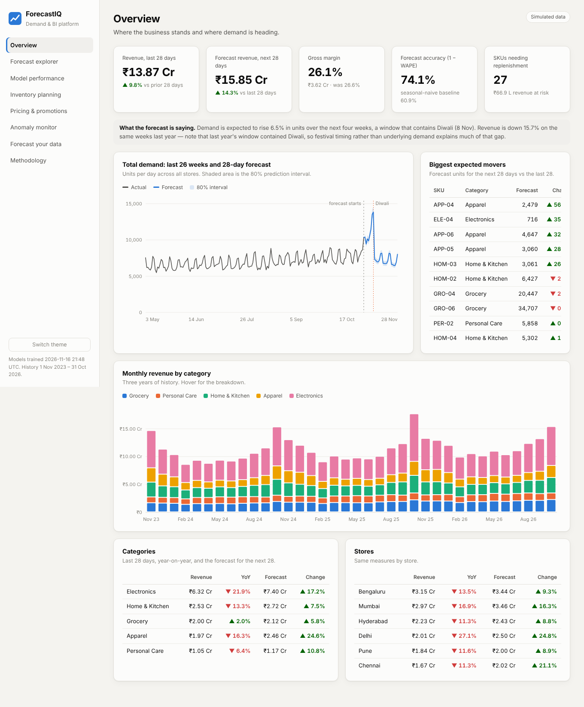
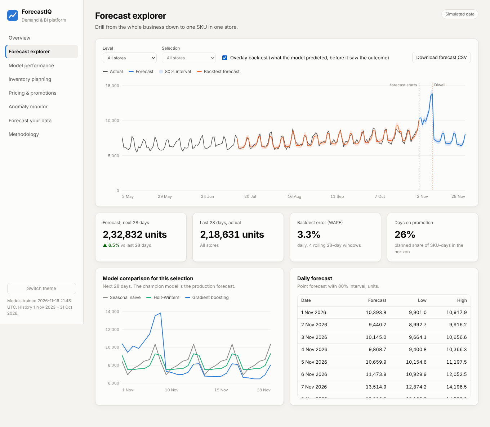
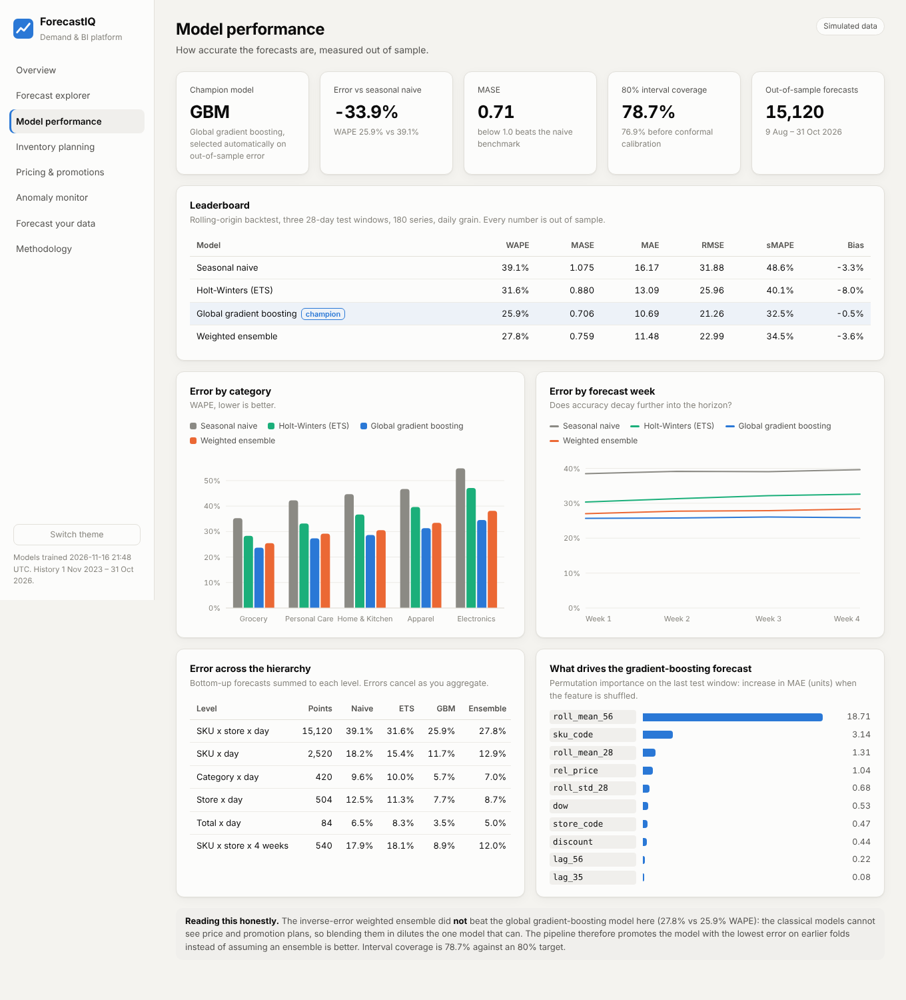
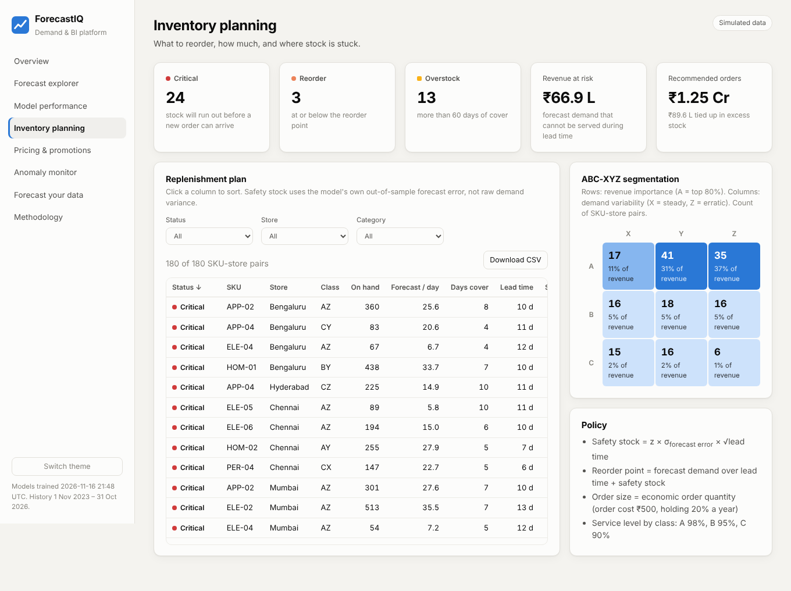
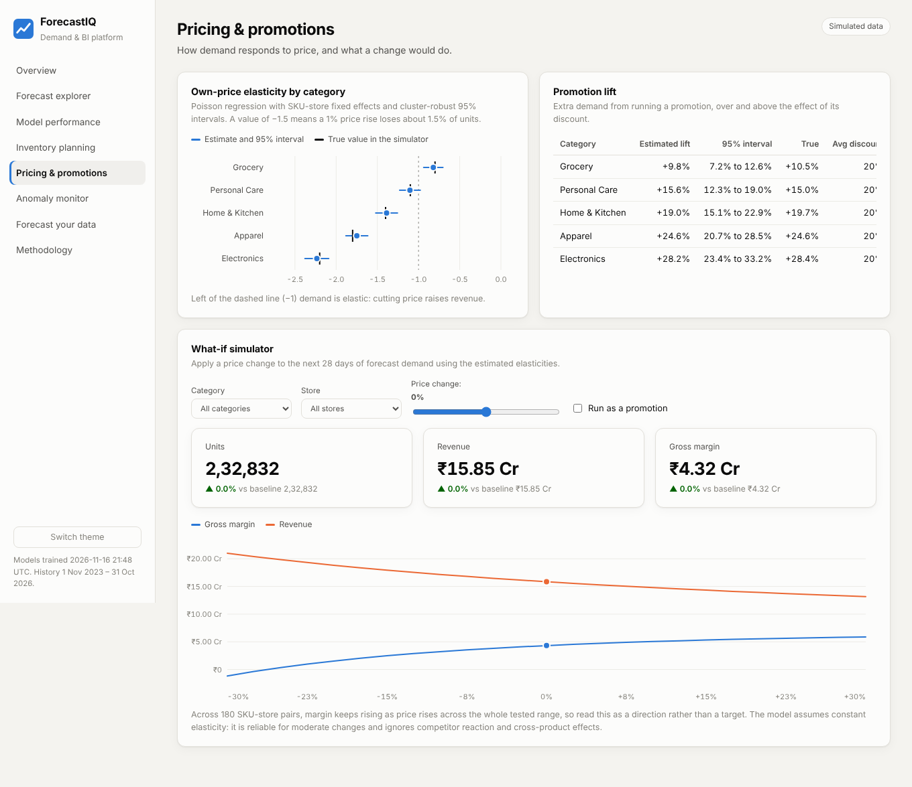

# ForecastIQ: Demand Forecasting & Business Intelligence Platform

Forecasts daily demand for 180 SKU-store series 28 days ahead with calibrated uncertainty, then turns the forecasts into replenishment and pricing decisions behind a web dashboard.

**Live demo:** _add your URL here after deploying_



## Results

Rolling-origin backtest, three 28-day test windows, 15,120 out-of-sample daily forecasts.

| Model | WAPE | MASE | RMSE | Bias |
|---|---|---|---|---|
| Seasonal naive (benchmark) | 39.1% | 1.075 | 31.88 | -3.3% |
| Holt-Winters ETS (from scratch) | 31.6% | 0.880 | 25.96 | -8.0% |
| **Global gradient boosting (champion)** | **25.9%** | **0.706** | **21.26** | **-0.5%** |
| Inverse-error weighted ensemble | 27.8% | 0.759 | 22.99 | -3.6% |

- 34% lower error than the seasonal-naive benchmark at SKU-store-day grain; 3.5% WAPE at total-day grain.
- 80% prediction intervals cover 78.7% of outcomes after conformal calibration (76.9% before).
- Price elasticities recovered to within 0.06 of the simulator's true values in all five categories.
- Anomaly detector: 64% precision, 72% event recall against injected stock-outs and spikes.

The ensemble did **not** beat the single global model, so the pipeline's champion/challenger step promoted the global model. The classical models cannot see price and promotion plans, and blending them in dilutes the model that can.

## About the data

**The data is simulated.** Demand is generated by an explicit structural model: store and product trends, weekly and yearly seasonality, an Indian festival calendar with moving dates, price elasticity, promotion lift, autocorrelated noise and negative-binomial counts, with stock-outs and demand spikes injected. This is a deliberate choice: because the true elasticities and anomalies are known, the analytics modules are validated against ground truth in the test suite. The cost is that simulated data is cleaner than real point-of-sale data. `forecastiq/data.py` is the only module that would change to run on a real dataset.

## What is in it

| Area | Method |
|---|---|
| Forecasting | Global `HistGradientBoostingRegressor` with a Poisson objective, 30 features, direct non-recursive 28-day horizon (every demand feature lagged by at least the horizon) |
| Classical baseline | Damped additive Holt-Winters on the log scale, implemented in NumPy and vectorised across all series, per-series parameter search |
| Uncertainty | Pinball-loss quantile models plus conformalised quantile regression (CQR), calibrated only on earlier folds |
| Evaluation | Rolling-origin cross-validation; WAPE, MASE, RMSE, sMAPE, bias, pinball loss; errors at six levels of the hierarchy |
| Model selection | Automatic champion/challenger on out-of-sample error |
| Inventory | ABC-XYZ segmentation; (s, Q) policy with safety stock sized from out-of-sample forecast error; EOQ |
| Pricing | Poisson pseudo-maximum-likelihood (IRLS) with SKU-store fixed effects and cluster-robust standard errors; what-if simulator |
| Monitoring | Negative-binomial anomaly scores, including joint probability of zero-sales runs |
| Serving | Flask REST API reading pre-computed JSON artifacts; dependency-free front end with hand-written SVG charts, light and dark themes |
| Quality | 32 pytest tests, including a feature-leakage test and ground-truth recovery tests; GitHub Actions CI |

## Architecture

```
forecastiq/data.py       structural simulator (ground truth known)
forecastiq/features.py   leakage-safe lag, rolling, price, calendar features
forecastiq/models.py     seasonal naive, Holt-Winters, global GBM, conformal utilities
forecastiq/evaluation.py metrics
forecastiq/analytics.py  KPIs, ABC-XYZ, inventory policy, elasticity, anomalies, scenarios
forecastiq/pipeline.py   backtest -> champion -> final forecast -> artifacts/*.json   (offline, ~2 min)
forecastiq/quick.py      on-demand forecast for an uploaded CSV
app.py                   Flask API + dashboard                                        (online, no training)
```

Training is offline and the web tier only reads artifacts, so the app starts in about a second, needs no scikit-learn at runtime, and fits a free 512 MB instance.

## Run locally

Requires Python 3.11 or newer (developed on 3.13).

```bash
python -m venv .venv && source .venv/bin/activate      # Windows: .venv\Scripts\activate
pip install -r requirements-train.txt
python app.py                                          # http://localhost:7860
```

The trained artifacts are committed, so the app runs immediately. To retrain from scratch and run the tests:

```bash
python -m forecastiq.pipeline      # about 2 minutes on a laptop
pytest -q
```

## Deploy for free (Render)

1. Push this folder to a GitHub repository.
2. On [render.com](https://render.com): **New > Blueprint**, choose the repository. `render.yaml` configures everything (free plan, health check, start command).
3. Wait for the first build, then open the `onrender.com` URL and paste it at the top of this README.

Free instances sleep after 15 minutes without traffic and take up to a minute to wake, so open the link once before a demo or an interview. The included `Dockerfile` runs the same app on any container host.

## API

| Endpoint | Returns |
|---|---|
| `GET /api/overview` | KPIs, monthly revenue, category and store tables |
| `GET /api/forecast?node=category:Apparel` | history, forecast, interval, backtest for any hierarchy node |
| `GET /api/performance` | leaderboard, per-category and per-level errors, coverage, feature importance |
| `GET /api/inventory` | replenishment plan and ABC-XYZ matrix |
| `GET /api/pricing` | elasticities and promotion lifts with confidence intervals |
| `POST /api/scenario` | what-if result and profit curve for a price change |
| `GET /api/anomalies` | flagged days and detector scorecard |
| `POST /api/forecast-upload` | forecast for an uploaded CSV (date, value) |

## Limits

- Simulated data: no assortment changes, returns, missing days or competitor effects.
- The what-if simulator assumes constant elasticity and no cross-product cannibalisation.
- Festival effects are learned from three years of history, so the Diwali forecast rests on three examples.
- Interval coverage is 78.7% against an 80% target, slightly under.

## Screenshots

| Forecast explorer | Model performance |
|---|---|
|  |  |

| Inventory planning | Pricing and promotions |
|---|---|
|  |  |
